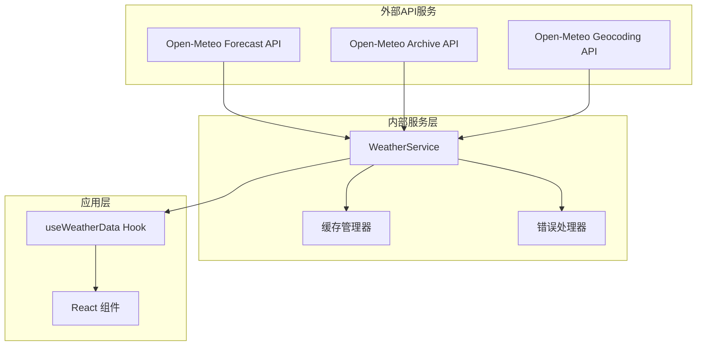
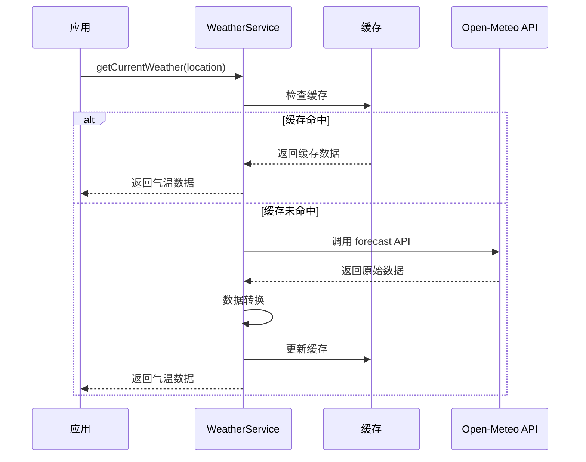
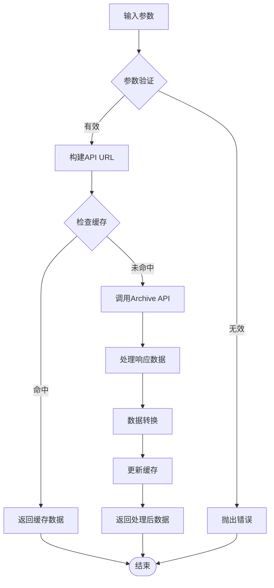
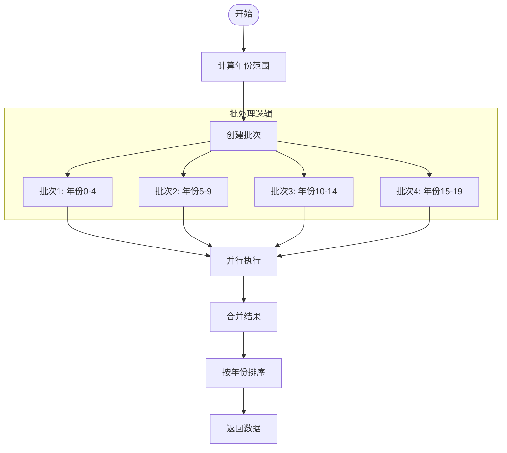
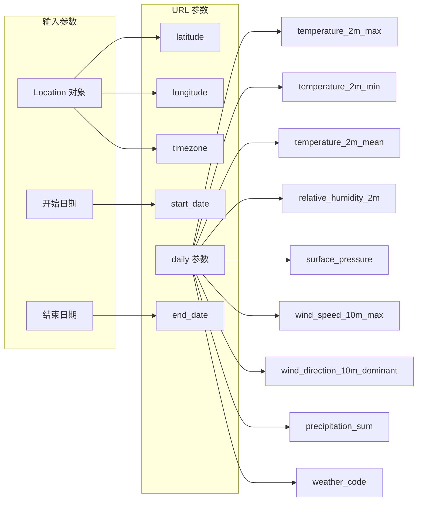
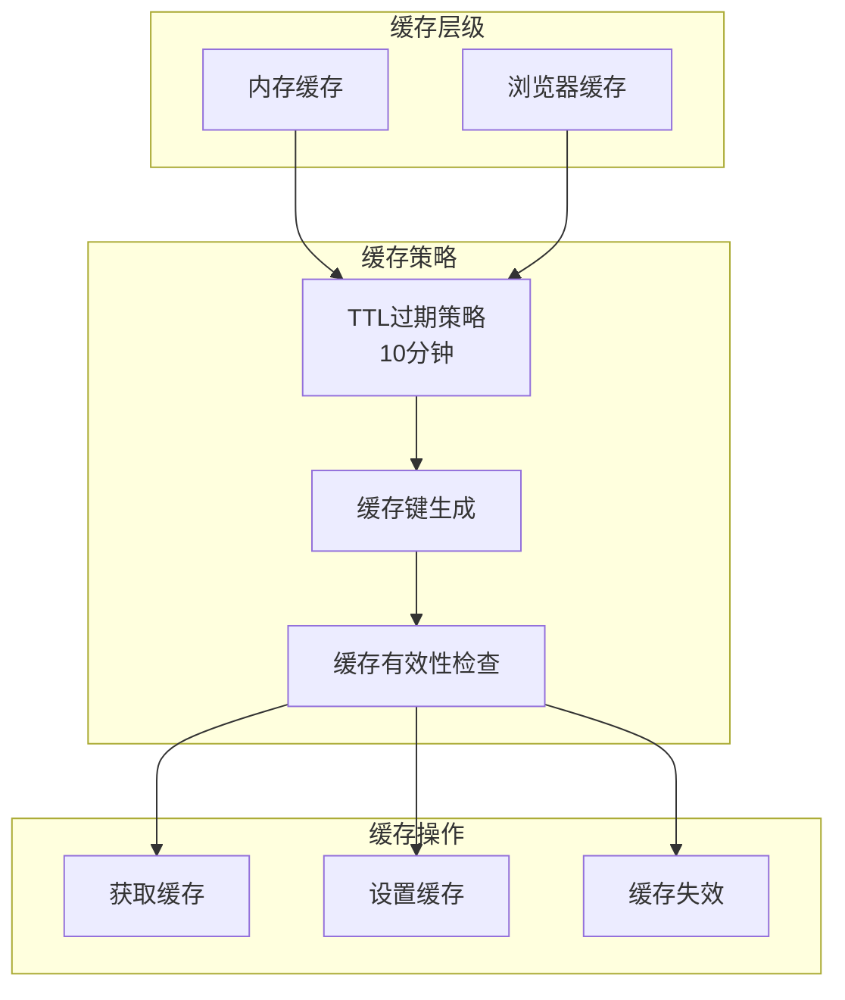
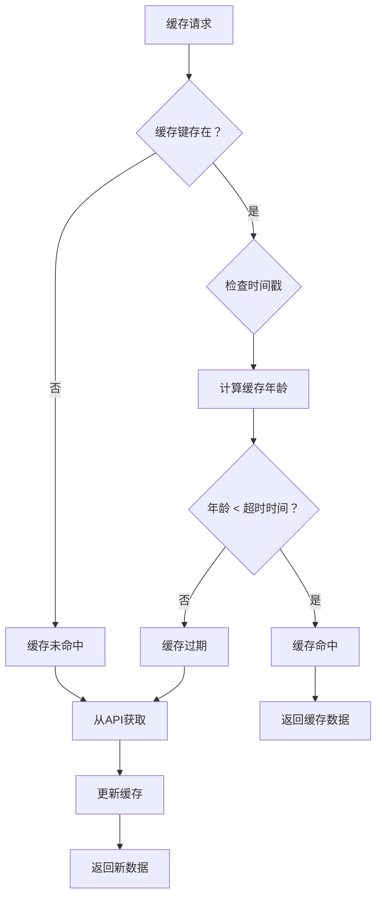
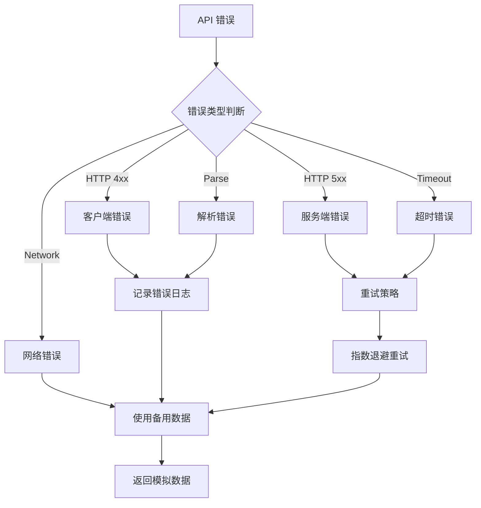
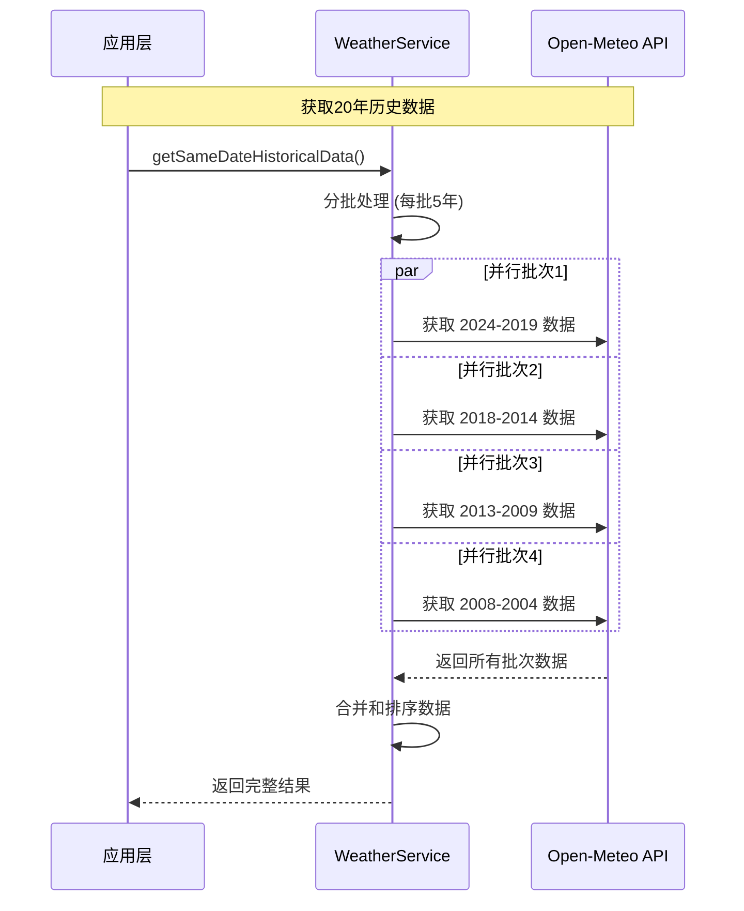
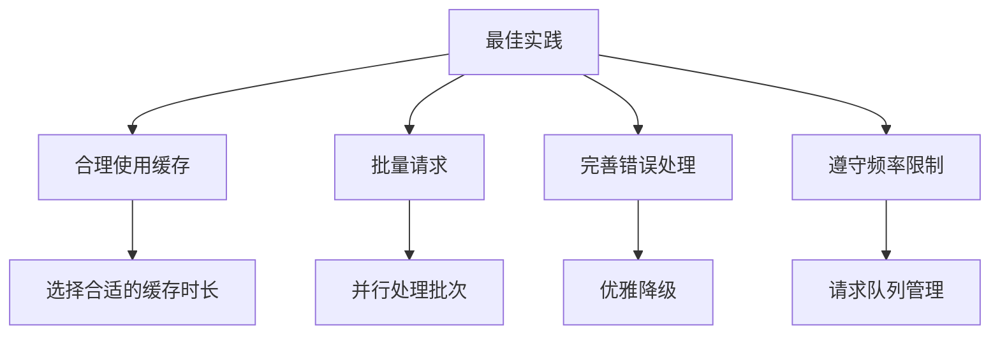

# API 文档 - 历史气温数据分析平台

## 1. API 概览

本系统主要集成了 Open-Meteo 天气API服务，提供全球范围内的历史和实时气温数据。

### 1.1 API 服务架构



## 2. WeatherService 核心API

### 2.1 类定义

```typescript
class WeatherService {
  private cache: Map<string, { data: any; timestamp: number }>;
  private cacheTimeout: number = 10 * 60 * 1000; // 10分钟
}
```

### 2.2 主要方法

#### 2.2.1 getCurrentWeather()

获取指定位置的当前气温数据。

```typescript
async getCurrentWeather(location: Location): Promise<WeatherDataPoint>
```

**参数:**
- `location: Location` - 地理位置信息

**返回值:**
- `Promise<WeatherDataPoint>` - 当前气温数据点

**API调用流程:**


**示例:**
```typescript
const currentWeather = await weatherService.getCurrentWeather({
  id: 'shanghai',
  name: '上海',
  latitude: 31.2304,
  longitude: 121.4737,
  country: 'China',
  timezone: 'Asia/Shanghai'
});
```

#### 2.2.2 getHistoricalWeather()

获取指定位置和时间范围的历史气温数据。

```typescript
async getHistoricalWeather(
  location: Location, 
  startDate: Date, 
  endDate: Date
): Promise<WeatherDataPoint[]>
```

**参数:**
- `location: Location` - 地理位置信息
- `startDate: Date` - 开始日期
- `endDate: Date` - 结束日期

**返回值:**
- `Promise<WeatherDataPoint[]>` - 历史气温数据数组

**数据处理流程:**


#### 2.2.3 getSameDateHistoricalData()

获取同一日期跨多年的历史数据，用于年际对比分析。

```typescript
async getSameDateHistoricalData(
  location: Location, 
  targetDate: Date = new Date(), 
  years: number = 20
): Promise<WeatherDataPoint[]>
```

**参数:**
- `location: Location` - 地理位置信息
- `targetDate: Date` - 目标日期（默认当天）
- `years: number` - 年份数量（默认20年）

**批处理策略:**


#### 2.2.4 searchLocations()

搜索地理位置信息。

```typescript
async searchLocations(query: string): Promise<Location[]>
```

**参数:**
- `query: string` - 搜索关键词

**返回值:**
- `Promise<Location[]>` - 匹配的位置列表

## 3. Open-Meteo API 集成

### 3.1 API 端点

| API 类型 | 端点 | 用途 |
|---------|------|------|
| Forecast API | `https://api.open-meteo.com/v1/forecast` | 当前和未来天气 |
| Archive API | `https://archive-api.open-meteo.com/v1/archive` | 历史气温数据 |
| Geocoding API | `https://geocoding-api.open-meteo.com/v1/search` | 地理位置搜索 |

### 3.2 请求参数映射

#### 3.2.1 历史数据请求



#### 3.2.2 响应数据转换

```mermaid
flowchart TD
    APIResponse[Open-Meteo API 响应] --> ExtractDaily[提取 daily 对象]
    ExtractDaily --> MapArrays[映射数组数据]
    
    subgraph "数组映射过程"
        MapArrays --> TimeArray[time[]]
        MapArrays --> TempArray[temperature_2m_mean[]]
        MapArrays --> HumidityArray[relative_humidity_2m[]]
        MapArrays --> PressureArray[surface_pressure[]]
    end
    
    TimeArray --> CreateDataPoint[创建 WeatherDataPoint]
    TempArray --> CreateDataPoint
    HumidityArray --> CreateDataPoint
    PressureArray --> CreateDataPoint
    
    CreateDataPoint --> ApplyWeatherCode[应用天气代码映射]
    ApplyWeatherCode --> FinalData[最终数据对象]
```

### 3.3 天气代码映射

```typescript
const weatherCodeMap: { [key: number]: string } = {
  0: '晴朗',
  1: '基本晴朗', 
  2: '多云',
  3: '阴天',
  45: '雾',
  51: '小雨',
  53: '中雨',
  55: '大雨',
  61: '小雨',
  63: '中雨', 
  65: '大雨',
  71: '小雪',
  73: '中雪',
  75: '大雪',
  95: '雷暴'
  // ... 更多映射
};
```

## 4. 缓存机制

### 4.1 缓存策略



### 4.2 缓存键生成规则

```typescript
private getCacheKey(method: string, params: any): string {
  return `${method}_${JSON.stringify(params)}`;
}
```

**示例缓存键:**
- `current_{"lat":31.2304,"lon":121.4737}`
- `historical_{"lat":31.2304,"lon":121.4737,"start":"2023-01-01","end":"2023-12-31"}`
- `search_{"query":"shanghai"}`

### 4.3 缓存有效性检查



## 5. 错误处理

### 5.1 错误类型和处理策略



### 5.2 重试机制

```typescript
// 指数退避重试示例
async function fetchWithRetry(url: string, maxRetries: number = 3): Promise<any> {
  let retries = 0;
  while (retries < maxRetries) {
    try {
      const response = await fetch(url);
      if (!response.ok) throw new Error(`HTTP ${response.status}`);
      return await response.json();
    } catch (error) {
      retries++;
      if (retries >= maxRetries) throw error;
      
      // 指数退避: 2^retries * 1000ms
      const delay = Math.pow(2, retries) * 1000;
      await new Promise(resolve => setTimeout(resolve, delay));
    }
  }
}
```

## 6. 性能优化

### 6.1 批量请求优化



### 6.2 数据转换优化

```typescript
// 优化前：多次遍历
const processData = (rawData: any) => {
  const filtered = rawData.daily.time.filter((time: string, index: number) => 
    rawData.daily.temperature_2m_mean[index] != null
  );
  const mapped = filtered.map((time: string, index: number) => ({
    date: time,
    temperature: rawData.daily.temperature_2m_mean[index]
  }));
  return mapped.sort((a, b) => a.date.localeCompare(b.date));
};

// 优化后：单次遍历
const processDataOptimized = (rawData: any) => {
  return rawData.daily.time
    .map((time: string, index: number) => ({
      date: time,
      temperature: rawData.daily.temperature_2m_mean[index],
      humidity: rawData.daily.relative_humidity_2m[index],
      // ... 其他字段
    }))
    .filter(item => item.temperature != null)
    .sort((a, b) => a.date.localeCompare(b.date));
};
```

## 7. API 使用示例

### 7.1 基础用法

```typescript
import { weatherService } from '../services/weatherService';

// 1. 搜索地点
const locations = await weatherService.searchLocations('上海');
const shanghai = locations[0];

// 2. 获取当前天气
const currentWeather = await weatherService.getCurrentWeather(shanghai);
console.log(`当前温度: ${currentWeather.temperature}°C`);

// 3. 获取历史数据
const startDate = new Date('2023-01-01');
const endDate = new Date('2023-12-31');
const historicalData = await weatherService.getHistoricalWeather(
  shanghai, 
  startDate, 
  endDate
);

// 4. 获取同期历史数据
const sameDateData = await weatherService.getSameDateHistoricalData(
  shanghai, 
  new Date(), // 今天
  20 // 过去20年
);
```

### 7.2 React Hook 集成

```typescript
import { useWeatherData } from '../hooks/useWeatherData';

function WeatherComponent() {
  const { 
    data, 
    loading, 
    error, 
    refetch,
    searchLocations 
  } = useWeatherData({
    useRealData: true,
    selectedLocations: [shanghai],
    targetDate: new Date(),
    years: 20
  });

  if (loading) return <div>加载中...</div>;
  if (error) return <div>错误: {error}</div>;

  return (
    <div>
      {data.map(point => (
        <div key={point.date}>
          {point.date}: {point.temperature}°C
        </div>
      ))}
    </div>
  );
}
```

## 8. API 限制和注意事项

### 8.1 请求限制

| API 类型 | 限制 | 缓存建议 |
|---------|------|----------|
| Forecast API | 10,000 请求/天 | 10分钟 |
| Archive API | 10,000 请求/天 | 1小时 |
| Geocoding API | 10,000 请求/天 | 24小时 |

### 8.2 最佳实践



1. **缓存优先**: 优先使用缓存数据，减少API调用
2. **批量处理**: 将多个请求合并处理，提高效率
3. **错误恢复**: 实现完善的错误处理和重试机制
4. **监控使用**: 监控API使用量，避免超出限制
5. **数据验证**: 对返回数据进行验证和清理

通过以上API设计和实现，系统能够高效、稳定地获取和处理气温数据，为用户提供准确的历史气温分析功能。