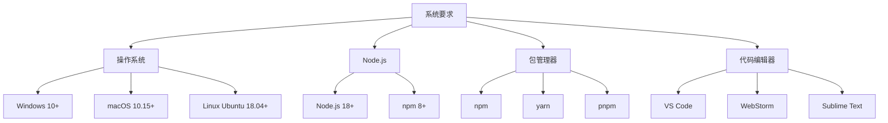
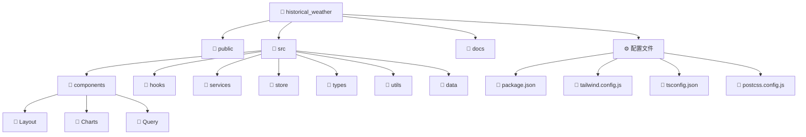
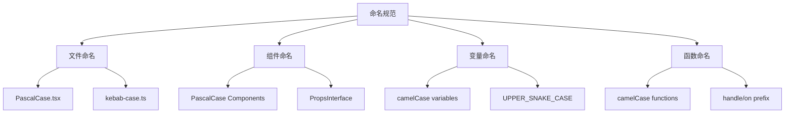
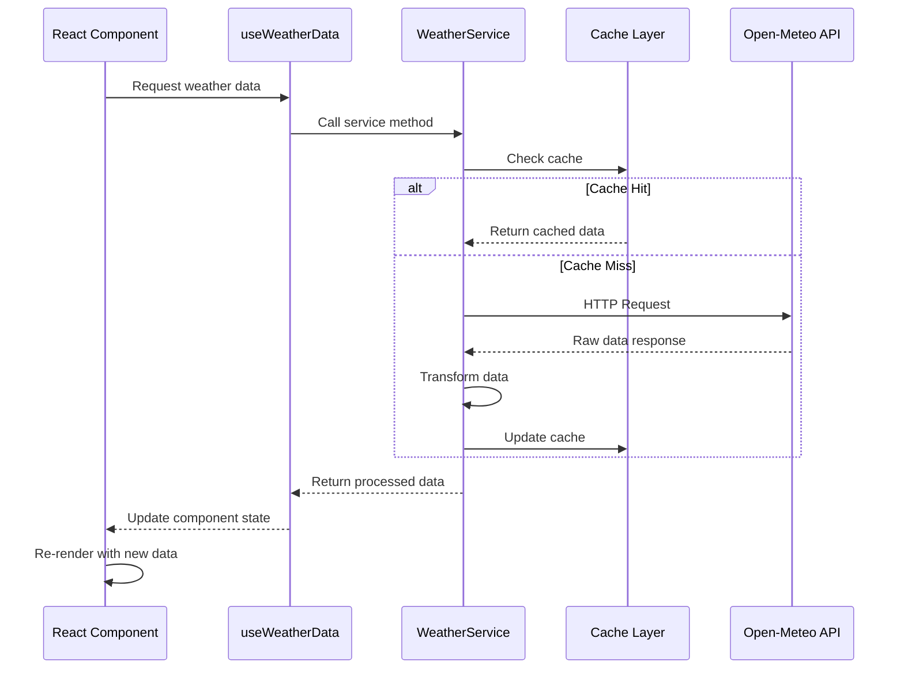
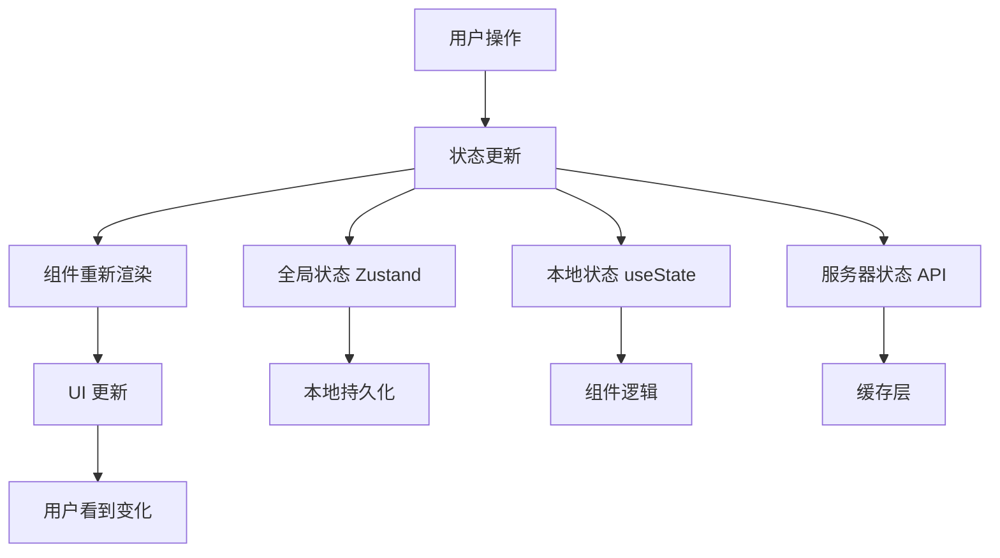
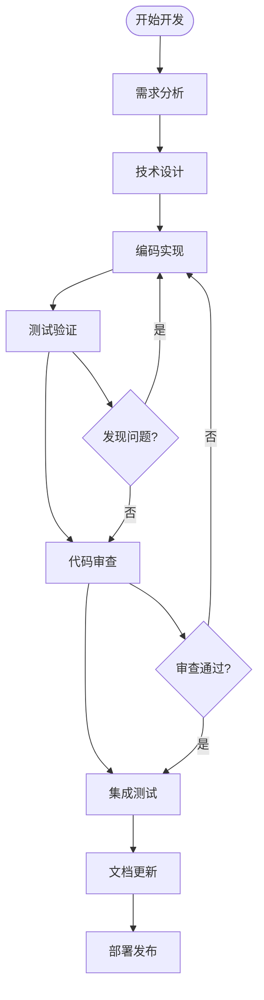
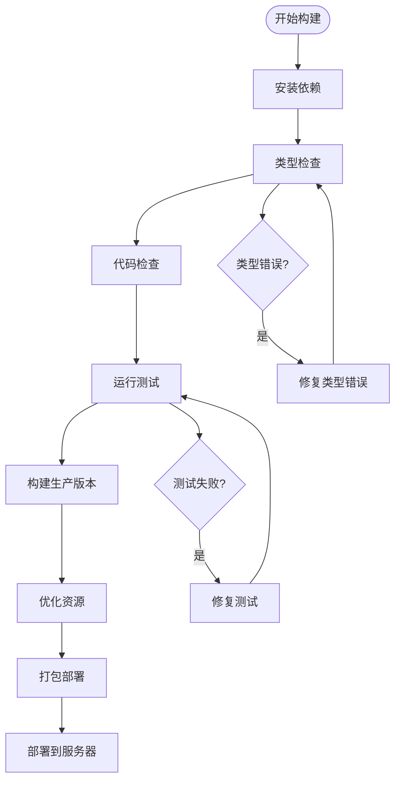
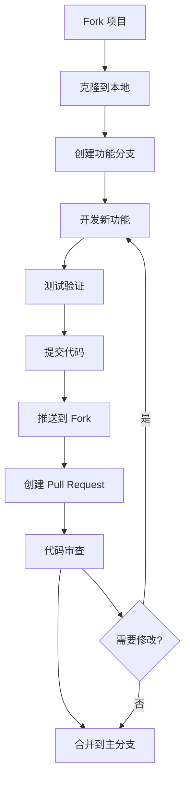

# 开发指南 - 历史气温数据分析平台

## 📋 目录

1. [开发环境搭建](#1-开发环境搭建)
2. [项目结构](#2-项目结构)
3. [开发规范](#3-开发规范)
4. [技术栈详解](#4-技术栈详解)
5. [核心概念](#5-核心概念)
6. [开发流程](#6-开发流程)
7. [测试策略](#7-测试策略)
8. [部署指南](#8-部署指南)
9. [贡献指南](#9-贡献指南)

## 1. 开发环境搭建

### 1.1 系统要求



### 1.2 安装步骤

#### 步骤 1: 克隆项目

```bash
git clone https://github.com/your-org/historical-weather.git
cd historical-weather
```

#### 步骤 2: 安装依赖

```bash
# 使用 npm
npm install

# 或使用 yarn
yarn install

# 或使用 pnpm
pnpm install
```

#### 步骤 3: 环境配置

```bash
# 复制环境变量模板
cp .env.example .env.local

# 编辑环境变量
vim .env.local
```

**环境变量说明:**
```env
# API 配置
REACT_APP_OPEN_METEO_BASE_URL=https://api.open-meteo.com/v1
REACT_APP_ARCHIVE_BASE_URL=https://archive-api.open-meteo.com/v1
REACT_APP_GEOCODING_BASE_URL=https://geocoding-api.open-meteo.com/v1

# 应用配置
REACT_APP_DEFAULT_LOCATION_ID=shanghai
REACT_APP_CACHE_TIMEOUT=600000
REACT_APP_MAX_LOCATIONS=5

# 调试配置
REACT_APP_DEBUG_MODE=false
REACT_APP_MOCK_DATA=false
```

#### 步骤 4: 启动开发服务器

```bash
npm start
```

### 1.3 开发工具配置

#### VSCode 推荐插件

```json
{
  "recommendations": [
    "bradlc.vscode-tailwindcss",
    "esbenp.prettier-vscode",
    "dbaeumer.vscode-eslint",
    "ms-vscode.vscode-typescript-next",
    "formulahendry.auto-rename-tag",
    "christian-kohler.path-intellisense",
    "ms-vscode.vscode-json"
  ]
}
```

#### VSCode 设置

```json
{
  "editor.formatOnSave": true,
  "editor.codeActionsOnSave": {
    "source.fixAll.eslint": true
  },
  "typescript.preferences.importModuleSpecifier": "relative",
  "tailwindCSS.includeLanguages": {
    "typescript": "javascript",
    "typescriptreact": "javascript"
  }
}
```

## 2. 项目结构

### 2.1 目录结构图



### 2.2 详细目录说明

```
historical_weather/
├── public/                 # 静态资源
│   ├── index.html         # HTML 模板
│   ├── manifest.json      # PWA 配置
│   └── favicon.ico        # 网站图标
├── src/                   # 源代码
│   ├── components/        # React 组件
│   │   ├── Layout/        # 布局组件
│   │   │   ├── Header.tsx
│   │   │   ├── Sidebar.tsx
│   │   │   └── MainLayout.tsx
│   │   ├── Charts/        # 图表组件
│   │   │   ├── WeatherChart.tsx
│   │   │   └── ChartContainer.tsx
│   │   └── Query/         # 查询组件
│   │       └── NaturalLanguageQuery.tsx
│   ├── hooks/             # 自定义 Hooks
│   │   └── useWeatherData.ts
│   ├── services/          # 服务层
│   │   └── weatherService.ts
│   ├── store/             # 状态管理
│   │   └── appStore.ts
│   ├── types/             # TypeScript 类型定义
│   │   └── weather.ts
│   ├── utils/             # 工具函数
│   │   └── historicalDataGenerator.ts
│   ├── data/              # 模拟数据
│   │   └── mockWeatherData.ts
│   ├── App.tsx            # 根组件
│   ├── index.tsx          # 入口文件
│   └── index.css          # 全局样式
├── docs/                  # 项目文档
│   ├── SYSTEM_ARCHITECTURE.md
│   ├── API_DOCUMENTATION.md
│   ├── USER_GUIDE.md
│   └── DEVELOPMENT_GUIDE.md
├── package.json           # 项目配置
├── tailwind.config.js     # Tailwind CSS 配置
├── tsconfig.json          # TypeScript 配置
├── postcss.config.js      # PostCSS 配置
└── .eslintrc.js          # ESLint 配置
```

## 3. 开发规范

### 3.1 代码风格规范

#### 3.1.1 命名规范



**具体规范:**

```typescript
// ✅ 组件命名 - PascalCase
interface WeatherChartProps {
  data: WeatherDataPoint[];
  type: 'line' | 'area' | 'bar';
}

const WeatherChart: React.FC<WeatherChartProps> = ({ data, type }) => {
  // ✅ 变量命名 - camelCase
  const [chartData, setChartData] = useState<WeatherDataPoint[]>([]);
  
  // ✅ 常量命名 - UPPER_SNAKE_CASE
  const MAX_DATA_POINTS = 1000;
  
  // ✅ 函数命名 - camelCase with descriptive verbs
  const handleChartTypeChange = useCallback((newType: string) => {
    setChartType(newType);
  }, []);
  
  // ✅ 事件处理函数 - handle/on prefix
  const onDataRefresh = () => {
    fetchWeatherData();
  };
  
  return <div>...</div>;
};

// ✅ 文件命名
// WeatherChart.tsx - 组件文件
// weatherService.ts - 服务文件
// useWeatherData.ts - Hook 文件
// weather.ts - 类型定义文件
```

#### 3.1.2 TypeScript 规范

```typescript
// ✅ 接口定义
interface WeatherDataPoint {
  readonly timestamp: string;
  readonly date: string;
  readonly temperature: number;
  readonly location: string;
}

// ✅ 类型别名
type ChartType = 'line' | 'area' | 'bar' | 'heatmap';
type LoadingState = 'idle' | 'loading' | 'success' | 'error';

// ✅ 泛型使用
interface ApiResponse<T> {
  data: T;
  status: 'success' | 'error';
  message?: string;
}

// ✅ 函数类型定义
type WeatherDataFetcher = (
  location: Location,
  dateRange: DateRange
) => Promise<WeatherDataPoint[]>;

// ✅ 可选属性和默认值
interface ChartOptions {
  showGrid?: boolean;
  showLegend?: boolean;
  height?: number;
  colors?: string[];
}

const defaultChartOptions: Required<ChartOptions> = {
  showGrid: true,
  showLegend: true,
  height: 400,
  colors: ['#1890ff', '#52c41a', '#faad14']
};
```

### 3.2 React 组件规范

#### 3.2.1 组件结构模板

```typescript
import React, { useState, useEffect, useCallback, useMemo } from 'react';
import { SomeIcon } from '@heroicons/react/24/outline';
import { useAppStore } from '../store/appStore';
import { WeatherDataPoint } from '../types/weather';
import clsx from 'clsx';

// 1. 接口定义
interface ComponentNameProps {
  data: WeatherDataPoint[];
  onDataChange?: (data: WeatherDataPoint[]) => void;
  className?: string;
}

// 2. 组件定义
const ComponentName: React.FC<ComponentNameProps> = ({
  data,
  onDataChange,
  className
}) => {
  // 3. Hooks 调用 (遵循 Rules of Hooks)
  const store = useAppStore();
  const [localState, setLocalState] = useState<string>('');
  
  // 4. 计算属性
  const processedData = useMemo(() => {
    return data.map(item => ({
      ...item,
      processed: true
    }));
  }, [data]);
  
  // 5. 副作用
  useEffect(() => {
    // 副作用逻辑
  }, [data]);
  
  // 6. 事件处理函数
  const handleDataChange = useCallback((newData: WeatherDataPoint[]) => {
    setLocalState('updated');
    onDataChange?.(newData);
  }, [onDataChange]);
  
  // 7. 条件渲染
  if (!data.length) {
    return <div className="text-center">暂无数据</div>;
  }
  
  // 8. 主要渲染
  return (
    <div className={clsx('component-base-class', className)}>
      {processedData.map(item => (
        <div key={item.timestamp} className="data-item">
          {/* 内容渲染 */}
        </div>
      ))}
    </div>
  );
};

export default ComponentName;
```

#### 3.2.2 Hooks 使用规范

```typescript
// ✅ 自定义 Hook 命名以 use 开头
export const useWeatherData = (options: UseWeatherDataOptions) => {
  // Hook 实现
  return { data, loading, error, refetch };
};

// ✅ Hook 依赖管理
const processedData = useMemo(() => {
  return data.map(transformData);
}, [data]); // 明确依赖

// ✅ useCallback 优化
const handleSubmit = useCallback((query: string) => {
  onSubmit(query);
}, [onSubmit]);

// ✅ useEffect 清理
useEffect(() => {
  const subscription = subscribeToData();
  return () => subscription.unsubscribe();
}, []);
```

### 3.3 样式规范

#### 3.3.1 Tailwind CSS 使用规范

```typescript
// ✅ 使用 clsx 进行条件样式
const buttonClasses = clsx(
  'px-4 py-2 rounded-md font-medium transition-colors',
  {
    'bg-blue-600 text-white hover:bg-blue-700': variant === 'primary',
    'bg-gray-200 text-gray-800 hover:bg-gray-300': variant === 'secondary',
    'opacity-50 cursor-not-allowed': disabled
  },
  className
);

// ✅ 响应式设计
<div className="grid grid-cols-1 md:grid-cols-2 lg:grid-cols-4 gap-4">
  {/* 内容 */}
</div>

// ✅ 深色模式支持
<div className="bg-white dark:bg-gray-900 text-gray-900 dark:text-white">
  {/* 内容 */}
</div>

// ✅ 自定义 CSS 变量
<div className="bg-primary text-primary border-custom">
  {/* 使用主题变量 */}
</div>
```

#### 3.3.2 CSS 变量定义

```css
/* src/index.css */
:root {
  /* Light theme */
  --bg-primary: #ffffff;
  --bg-secondary: #f8fafc;
  --text-primary: #1f2937;
  --text-secondary: #6b7280;
  --border-color: #d1d5db;
}

.dark {
  /* Dark theme */
  --bg-primary: #1f2937;
  --bg-secondary: #111827;
  --text-primary: #f9fafb;
  --text-secondary: #d1d5db;
  --border-color: #374151;
}
```

## 4. 技术栈详解

### 4.1 核心技术栈架构

```mermaid
graph TB
    subgraph "Frontend Framework"
        React[React 19]
        TypeScript[TypeScript 5.9]
        Vite[Create React App]
    end
    
    subgraph "State Management"
        Zustand[Zustand 5.0]
        LocalStorage[Local Storage Persistence]
    end
    
    subgraph "UI Framework"
        TailwindCSS[Tailwind CSS 3.4]
        HeadlessUI[Headless UI 2.2]
        HeroIcons[Hero Icons 2.2]
    end
    
    subgraph "Data Visualization"
        Recharts[Recharts 3.1]
        D3[D3.js (through Recharts)]
    end
    
    subgraph "HTTP Client"
        FetchAPI[Fetch API]
        AbortController[AbortController]
    end
    
    subgraph "Utilities"
        DateFns[date-fns 4.1]
        Clsx[clsx 2.1]
    end
    
    React --> TypeScript
    React --> Zustand
    React --> TailwindCSS
    React --> Recharts
    React --> FetchAPI
    React --> DateFns
```

### 4.2 技术选择理由

#### 4.2.1 React 19
- **并发渲染**: 提升大数据量场景下的性能
- **自动批处理**: 减少不必要的重新渲染
- **Suspense 支持**: 更好的异步数据处理

#### 4.2.2 Zustand vs Redux
```typescript
// ✅ Zustand - 简洁的状态管理
interface AppState {
  theme: 'light' | 'dark';
  selectedLocations: Location[];
  toggleTheme: () => void;
  addLocation: (location: Location) => void;
}

const useAppStore = create<AppState>()(
  persist(
    (set) => ({
      theme: 'light',
      selectedLocations: [],
      toggleTheme: () => set((state) => ({ 
        theme: state.theme === 'light' ? 'dark' : 'light' 
      })),
      addLocation: (location) => set((state) => ({
        selectedLocations: [...state.selectedLocations, location]
      }))
    }),
    { name: 'app-storage' }
  )
);
```

#### 4.2.3 Tailwind CSS vs Styled Components
- **性能优势**: 编译时优化，运行时零开销
- **一致性**: 设计系统内建，确保视觉一致性
- **开发效率**: 实用优先，快速原型开发

### 4.3 API 集成架构



## 5. 核心概念

### 5.1 数据流管理

#### 5.1.1 单向数据流



#### 5.1.2 状态分层

```typescript
// 1. 全局状态 - Zustand Store
interface GlobalState {
  theme: 'light' | 'dark';
  selectedLocations: Location[];
  sidebarOpen: boolean;
  queryHistory: QueryHistoryItem[];
}

// 2. 服务器状态 - Custom Hook
interface ServerState {
  data: WeatherDataPoint[];
  loading: boolean;
  error: string | null;
}

// 3. 本地状态 - Component State
interface LocalState {
  chartType: ChartType;
  selectedMetrics: string[];
  filterOptions: FilterOptions;
}
```

### 5.2 错误处理策略

#### 5.2.1 错误边界

```typescript
import React, { Component, ErrorInfo, ReactNode } from 'react';

interface Props {
  children: ReactNode;
  fallback?: ReactNode;
}

interface State {
  hasError: boolean;
  error?: Error;
}

class ErrorBoundary extends Component<Props, State> {
  public state: State = {
    hasError: false
  };

  public static getDerivedStateFromError(error: Error): State {
    return { hasError: true, error };
  }

  public componentDidCatch(error: Error, errorInfo: ErrorInfo) {
    console.error('Uncaught error:', error, errorInfo);
    // 发送错误报告到监控服务
    this.reportError(error, errorInfo);
  }

  private reportError(error: Error, errorInfo: ErrorInfo) {
    // 集成错误监控服务
    if (process.env.NODE_ENV === 'production') {
      // 发送错误到监控平台
    }
  }

  public render() {
    if (this.state.hasError) {
      return this.props.fallback || (
        <div className="error-fallback">
          <h2>出现了错误</h2>
          <p>请刷新页面重试</p>
        </div>
      );
    }

    return this.props.children;
  }
}
```

#### 5.2.2 异步错误处理

```typescript
// API 调用错误处理模式
const useAsyncOperation = <T>(
  operation: () => Promise<T>
) => {
  const [state, setState] = useState<{
    data: T | null;
    loading: boolean;
    error: string | null;
  }>({
    data: null,
    loading: false,
    error: null
  });

  const execute = useCallback(async () => {
    setState(prev => ({ ...prev, loading: true, error: null }));
    
    try {
      const data = await operation();
      setState({ data, loading: false, error: null });
    } catch (error) {
      const errorMessage = error instanceof Error 
        ? error.message 
        : 'Unknown error occurred';
      
      setState({ 
        data: null, 
        loading: false, 
        error: errorMessage 
      });
      
      // 记录错误
      console.error('Async operation failed:', error);
    }
  }, [operation]);

  return { ...state, execute };
};
```

### 5.3 性能优化策略

#### 5.3.1 组件优化

```typescript
// ✅ React.memo 优化
const WeatherChart = React.memo<WeatherChartProps>(
  ({ data, type, metrics }) => {
    // 组件实现
  },
  (prevProps, nextProps) => {
    // 自定义比较函数
    return (
      prevProps.type === nextProps.type &&
      prevProps.metrics.length === nextProps.metrics.length &&
      prevProps.data.length === nextProps.data.length
    );
  }
);

// ✅ useMemo 缓存计算结果
const processedData = useMemo(() => {
  return data.map(point => ({
    ...point,
    temperature: Math.round(point.temperature * 10) / 10
  }));
}, [data]);

// ✅ useCallback 缓存函数
const handleDataUpdate = useCallback((newData: WeatherDataPoint[]) => {
  setData(newData);
  onDataChange?.(newData);
}, [onDataChange]);
```

#### 5.3.2 懒加载和代码分割

```typescript
// ✅ 路由级别的代码分割
import { lazy, Suspense } from 'react';

const LazyWeatherChart = lazy(() => import('./components/Charts/WeatherChart'));
const LazyAnalysisPage = lazy(() => import('./pages/AnalysisPage'));

// ✅ 使用 Suspense 包装
function App() {
  return (
    <Suspense fallback={<div>Loading...</div>}>
      <Routes>
        <Route path="/chart" element={<LazyWeatherChart />} />
        <Route path="/analysis" element={<LazyAnalysisPage />} />
      </Routes>
    </Suspense>
  );
}

// ✅ 动态导入
const loadHeavyLibrary = async () => {
  const { default: heavyLib } = await import('./utils/heavyCalculations');
  return heavyLib;
};
```

## 6. 开发流程

### 6.1 功能开发流程



### 6.2 分支管理策略

```mermaid
gitgraph
    commit id: "Initial"
    branch develop
    checkout develop
    commit id: "Setup dev"
    
    branch feature/weather-api
    checkout feature/weather-api
    commit id: "Add API service"
    commit id: "Add error handling"
    
    checkout develop
    merge feature/weather-api
    commit id: "Merge API feature"
    
    branch feature/charts
    checkout feature/charts
    commit id: "Add chart components"
    commit id: "Add interactions"
    
    checkout develop
    merge feature/charts
    commit id: "Merge charts"
    
    checkout main
    merge develop
    commit id: "Release v1.0.0"
```

**分支规范:**
- `main`: 生产环境分支，只接受 release 合并
- `develop`: 开发主分支，功能分支合并目标
- `feature/*`: 功能开发分支
- `hotfix/*`: 生产环境紧急修复
- `release/*`: 发布准备分支

### 6.3 提交消息规范

```bash
# 提交消息格式
<type>(<scope>): <subject>

<body>

<footer>
```

**类型说明:**
- `feat`: 新功能
- `fix`: 错误修复
- `docs`: 文档更新
- `style`: 代码格式调整
- `refactor`: 代码重构
- `perf`: 性能优化
- `test`: 测试相关
- `chore`: 构建或工具相关

**示例:**
```bash
feat(weather-api): add historical data fetching

Add support for fetching historical weather data from Open-Meteo API
- Implement WeatherService.getHistoricalWeather method
- Add caching mechanism for API responses
- Handle API rate limiting and errors

Closes #123
```

## 7. 测试策略

### 7.1 测试金字塔

```mermaid
pyramid
    title 测试金字塔
    A[E2E Tests<br/>端到端测试<br/>5%]
    B[Integration Tests<br/>集成测试<br/>25%]
    C[Unit Tests<br/>单元测试<br/>70%]
```

### 7.2 单元测试

#### 7.2.1 工具函数测试

```typescript
// utils/__tests__/historicalDataGenerator.test.ts
import { generateSameDateHistoricalData, calculateHistoricalStats } from '../historicalDataGenerator';

describe('historicalDataGenerator', () => {
  const mockLocation = {
    id: 'test',
    name: '测试城市',
    latitude: 31.2304,
    longitude: 121.4737,
    country: 'Test',
    timezone: 'Asia/Shanghai'
  };

  describe('generateSameDateHistoricalData', () => {
    it('should generate correct number of data points', () => {
      const result = generateSameDateHistoricalData(mockLocation, new Date(), 5);
      expect(result).toHaveLength(5);
    });

    it('should generate data for same date across years', () => {
      const targetDate = new Date('2024-06-15');
      const result = generateSameDateHistoricalData(mockLocation, targetDate, 3);
      
      result.forEach(point => {
        const pointDate = new Date(point.date);
        expect(pointDate.getMonth()).toBe(targetDate.getMonth());
        expect(pointDate.getDate()).toBe(targetDate.getDate());
      });
    });
  });

  describe('calculateHistoricalStats', () => {
    it('should return null for empty data', () => {
      const result = calculateHistoricalStats([]);
      expect(result).toBeNull();
    });

    it('should calculate correct statistics', () => {
      const mockData = [
        { temperature: 20 },
        { temperature: 25 },
        { temperature: 30 }
      ] as any[];

      const result = calculateHistoricalStats(mockData);
      expect(result?.avgTemperature).toBe(25);
      expect(result?.maxTemperature).toBe(30);
      expect(result?.minTemperature).toBe(20);
    });
  });
});
```

#### 7.2.2 组件测试

```typescript
// components/__tests__/WeatherChart.test.tsx
import { render, screen } from '@testing-library/react';
import WeatherChart from '../Charts/WeatherChart';

const mockData = [
  {
    date: '2024-01-01',
    temperature: 15,
    humidity: 80,
    location: '测试城市'
  }
];

describe('WeatherChart', () => {
  it('renders without crashing', () => {
    render(
      <WeatherChart 
        data={mockData} 
        type="line" 
        metrics={['temperature']} 
      />
    );
    expect(screen.getByRole('img')).toBeInTheDocument();
  });

  it('displays empty state when no data provided', () => {
    render(
      <WeatherChart 
        data={[]} 
        type="line" 
        metrics={['temperature']} 
      />
    );
    expect(screen.getByText('暂无数据')).toBeInTheDocument();
  });

  it('handles different chart types', () => {
    const { rerender } = render(
      <WeatherChart 
        data={mockData} 
        type="line" 
        metrics={['temperature']} 
      />
    );

    rerender(
      <WeatherChart 
        data={mockData} 
        type="bar" 
        metrics={['temperature']} 
      />
    );

    expect(screen.getByRole('img')).toBeInTheDocument();
  });
});
```

### 7.3 集成测试

```typescript
// hooks/__tests__/useWeatherData.integration.test.ts
import { renderHook, act } from '@testing-library/react';
import { useWeatherData } from '../useWeatherData';

// Mock the weather service
jest.mock('../../services/weatherService', () => ({
  weatherService: {
    getSameDateHistoricalData: jest.fn(),
    searchLocations: jest.fn()
  }
}));

describe('useWeatherData Integration', () => {
  it('fetches data on mount', async () => {
    const { result } = renderHook(() => 
      useWeatherData({ 
        useRealData: false,
        selectedLocations: [],
        targetDate: new Date(),
        years: 20 
      })
    );

    expect(result.current.loading).toBe(true);

    // Wait for async operations
    await act(async () => {
      await new Promise(resolve => setTimeout(resolve, 0));
    });

    expect(result.current.loading).toBe(false);
    expect(result.current.data).toEqual(expect.any(Array));
  });

  it('handles API errors gracefully', async () => {
    // Mock API to throw error
    const mockError = new Error('API Error');
    require('../../services/weatherService').weatherService.getSameDateHistoricalData
      .mockRejectedValueOnce(mockError);

    const { result } = renderHook(() => 
      useWeatherData({ 
        useRealData: true,
        selectedLocations: [mockLocation],
        targetDate: new Date(),
        years: 20 
      })
    );

    await act(async () => {
      await new Promise(resolve => setTimeout(resolve, 100));
    });

    expect(result.current.error).toBeTruthy();
    expect(result.current.loading).toBe(false);
  });
});
```

### 7.4 E2E 测试

```typescript
// e2e/weather-app.spec.ts (Playwright)
import { test, expect } from '@playwright/test';

test.describe('Weather Application', () => {
  test.beforeEach(async ({ page }) => {
    await page.goto('http://localhost:3001');
  });

  test('should display default Shanghai data', async ({ page }) => {
    // Check if the chart is displayed
    await expect(page.locator('[data-testid="weather-chart"]')).toBeVisible();
    
    // Check if Shanghai data is shown
    await expect(page.locator('text=上海历史同期数据')).toBeVisible();
  });

  test('should allow adding new location', async ({ page }) => {
    // Open sidebar
    await page.click('[data-testid="menu-toggle"]');
    
    // Click add location button
    await page.click('[data-testid="add-location"]');
    
    // Search for Beijing
    await page.fill('[data-testid="location-search"]', '北京');
    
    // Select from suggestions
    await page.click('text=北京');
    
    // Verify location was added
    await expect(page.locator('text=北京')).toBeVisible();
  });

  test('should handle theme switching', async ({ page }) => {
    // Click theme toggle
    await page.click('[data-testid="theme-toggle"]');
    
    // Check if dark theme is applied
    await expect(page.locator('body')).toHaveClass(/dark/);
  });
});
```

## 8. 部署指南

### 8.1 构建流程



### 8.2 构建命令

```bash
# 开发环境
npm run start

# 生产构建
npm run build

# 类型检查
npx tsc --noEmit

# 运行测试
npm run test

# 静态分析
npm run lint
```

### 8.3 部署配置

#### 8.3.1 Nginx 配置

```nginx
server {
    listen 80;
    server_name your-domain.com;
    root /var/www/historical-weather/build;
    index index.html;

    # Gzip compression
    gzip on;
    gzip_vary on;
    gzip_min_length 10240;
    gzip_proxied expired no-cache no-store private must-revalidate auth;
    gzip_types
        text/plain
        text/css
        text/xml
        text/javascript
        application/javascript
        application/xml+rss
        application/json;

    # Handle client-side routing
    location / {
        try_files $uri $uri/ /index.html;
    }

    # Cache static assets
    location ~* \.(js|css|png|jpg|jpeg|gif|ico|svg)$ {
        expires 1y;
        add_header Cache-Control "public, immutable";
    }

    # Security headers
    add_header X-Frame-Options "SAMEORIGIN" always;
    add_header X-XSS-Protection "1; mode=block" always;
    add_header X-Content-Type-Options "nosniff" always;
    add_header Referrer-Policy "no-referrer-when-downgrade" always;
    add_header Content-Security-Policy "default-src 'self' http: https: data: blob: 'unsafe-inline'" always;
}
```

#### 8.3.2 Docker 配置

```dockerfile
# Dockerfile
FROM node:18-alpine as build

WORKDIR /app
COPY package*.json ./
RUN npm ci --only=production

COPY . .
RUN npm run build

FROM nginx:alpine
COPY --from=build /app/build /usr/share/nginx/html
COPY nginx.conf /etc/nginx/conf.d/default.conf

EXPOSE 80
CMD ["nginx", "-g", "daemon off;"]
```

```yaml
# docker-compose.yml
version: '3.8'
services:
  weather-app:
    build: .
    ports:
      - "3001:80"
    environment:
      - NODE_ENV=production
    restart: unless-stopped
```

## 9. 贡献指南

### 9.1 贡献流程



### 9.2 开发规范检查清单

#### 代码质量检查
- [ ] 代码符合 ESLint 规则
- [ ] TypeScript 类型定义完整
- [ ] 组件 Props 接口定义清晰
- [ ] 错误处理完善
- [ ] 性能优化合理

#### 测试覆盖
- [ ] 单元测试覆盖核心逻辑
- [ ] 组件测试覆盖主要功能
- [ ] 集成测试验证数据流
- [ ] E2E 测试覆盖关键用户路径

#### 文档更新
- [ ] 代码注释清晰
- [ ] README 更新
- [ ] API 文档更新
- [ ] 架构文档更新

#### 兼容性检查
- [ ] 浏览器兼容性测试
- [ ] 移动端适配验证
- [ ] 主题切换功能正常
- [ ] 响应式布局正确

### 9.3 Issue 管理

**Bug 报告模板:**
```markdown
## 🐛 Bug 描述
简洁清晰地描述这个 bug

## 🔄 重现步骤
1. 进入 '...'
2. 点击 '....'
3. 滚动到 '....'
4. 看到错误

## ✅ 期望行为
描述期望发生的行为

## 📱 环境信息
- OS: [e.g. iOS]
- Browser: [e.g. chrome, safari]
- Version: [e.g. 22]

## 📎 附加信息
添加任何其他关于问题的上下文信息
```

**功能请求模板:**
```markdown
## 🚀 功能描述
简洁清晰地描述功能需求

## 💡 解决方案
描述你希望如何实现这个功能

## 🔄 替代方案
描述你考虑过的替代解决方案

## 📎 附加信息
添加任何其他相关信息
```

---

通过遵循本开发指南，我们可以确保代码质量、团队协作效率和产品的长期可维护性。如有任何问题或建议，欢迎通过 Issue 或 Discussion 与我们交流！