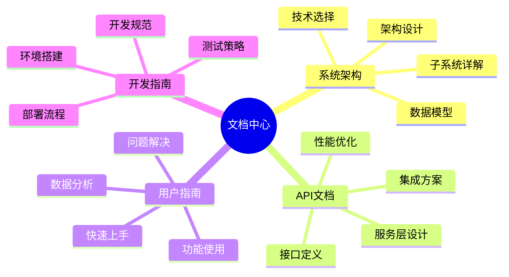
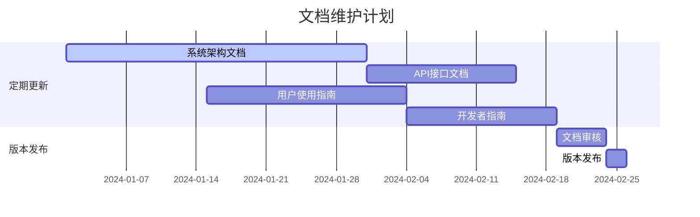

# 📚 历史天气数据分析平台 - 文档中心

欢迎访问历史天气数据分析平台的完整文档中心！这里包含了所有您需要了解的关于平台架构、开发、使用和维护的详细信息。

## 📋 文档导航

### 🏗️ [系统架构文档](./SYSTEM_ARCHITECTURE.md)
深入了解平台的整体架构设计、技术栈选择和各个子系统的详细说明。

**包含内容:**
- 🎯 系统概览和技术栈
- 🏛️ 整体架构和分层设计  
- 🧩 核心子系统详解
- 📊 数据模型定义
- ⚡ 性能优化策略
- 🛡️ 错误处理机制
- 🚀 未来扩展计划

### 🔌 [API 接口文档](./API_DOCUMENTATION.md)
WeatherService 核心API、Open-Meteo集成、缓存机制等技术细节。

**包含内容:**
- 🌐 API 服务架构
- 📡 WeatherService 核心API
- 🗄️ Open-Meteo API 集成
- 💾 缓存机制设计
- ❌ 错误处理策略
- 📈 性能优化方案
- 💡 最佳实践指南

### 👥 [用户使用指南](./USER_GUIDE.md)
面向最终用户的完整使用手册，从入门到精通。

**包含内容:**
- 🚀 快速开始指南
- 🎛️ 功能详细介绍
- 📈 数据分析方法
- 🔍 操作流程说明
- ❓ 常见问题解答
- 💡 使用技巧和建议

### 🛠️ [开发者指南](./DEVELOPMENT_GUIDE.md)
为开发者准备的技术开发指南，包含环境搭建到部署的全流程。

**包含内容:**
- 💻 开发环境搭建
- 📁 项目结构说明
- 📝 代码规范要求
- 🧪 测试策略设计
- 🚀 部署配置指南
- 🤝 贡献流程说明

## 🎯 快速导航

## 📖 阅读建议

### 👨‍💼 产品经理 / 项目经理
1. 先阅读 [用户使用指南](./USER_GUIDE.md) 了解产品功能
2. 查看 [系统架构文档](./SYSTEM_ARCHITECTURE.md) 中的系统概览部分
3. 关注未来扩展计划和功能路线图

### 👩‍💻 前端开发者
1. 从 [开发者指南](./DEVELOPMENT_GUIDE.md) 开始，搭建开发环境
2. 详细阅读代码规范和项目结构说明
3. 参考 [系统架构文档](./SYSTEM_ARCHITECTURE.md) 理解整体设计
4. 查看 [API 文档](./API_DOCUMENTATION.md) 了解数据层接口

### 🔧 后端开发者
1. 重点阅读 [API 接口文档](./API_DOCUMENTATION.md)
2. 了解 [系统架构文档](./SYSTEM_ARCHITECTURE.md) 中的服务层设计
3. 查看错误处理和性能优化策略

### 🎨 UI/UX 设计师
1. 通过 [用户使用指南](./USER_GUIDE.md) 了解用户交互流程
2. 查看 [系统架构文档](./SYSTEM_ARCHITECTURE.md) 中的用户界面层设计
3. 关注响应式设计和主题切换功能

### 🧪 测试工程师
1. 重点关注 [开发者指南](./DEVELOPMENT_GUIDE.md) 中的测试策略
2. 了解 [用户使用指南](./USER_GUIDE.md) 中的功能操作流程
3. 查看 [系统架构文档](./SYSTEM_ARCHITECTURE.md) 中的错误处理机制

### 🚀 运维工程师
1. 详细阅读 [开发者指南](./DEVELOPMENT_GUIDE.md) 中的部署配置
2. 了解 [系统架构文档](./SYSTEM_ARCHITECTURE.md) 中的性能优化策略
3. 关注 [API 文档](./API_DOCUMENTATION.md) 中的缓存和错误处理机制

## 🔄 文档更新说明

### 📅 更新频率
- **系统架构文档**: 每个主要版本更新
- **API 接口文档**: 每次API变更后更新
- **用户使用指南**: 每次功能发布后更新
- **开发者指南**: 技术栈升级或流程变更时更新

### ✅ 文档质量保证
- 所有文档都经过技术审查
- Mermaid 图表定期检查和优化
- 示例代码保持与最新版本同步
- 用户反馈及时反映到文档更新中

## 🤝 贡献指南

### 📝 文档贡献
我们欢迎社区成员贡献文档内容！

**贡献方式:**
1. 发现文档错误或不准确之处，请提交 Issue
2. 希望改进文档内容，请提交 Pull Request
3. 有新的使用场景或最佳实践，请分享给我们
4. 对文档结构有建议，请在 Discussions 中讨论

**文档规范:**
- 使用清晰的中文表达
- 代码示例保持最新和可执行
- Mermaid 图表美观且信息准确
- 遵循现有的文档结构和风格

### 🌟 文档反馈
如果您在使用文档过程中遇到任何问题，请通过以下方式联系我们：

- 📧 通过 GitHub Issues 报告文档问题
- 💬 在 GitHub Discussions 中讨论文档改进建议
- 📝 通过 Pull Request 直接提交文档改进

## 🔗 相关链接

- 🏠 [项目主页](../README.md)
- 🐙 [GitHub 仓库](https://github.com/your-org/historical-weather)
- 🌐 [在线演示](https://your-demo-site.com)
- 📊 [项目看板](https://github.com/your-org/historical-weather/projects)
- 💬 [讨论区](https://github.com/your-org/historical-weather/discussions)

## 📊 文档统计

| 文档名称 | 字数 | Mermaid图表 | 更新日期 |
|---------|------|------------|----------|
| 系统架构文档 | ~8,000 | 15+ | 2024-01-01 |
| API接口文档 | ~6,000 | 10+ | 2024-01-01 |
| 用户使用指南 | ~7,000 | 12+ | 2024-01-01 |
| 开发者指南 | ~9,000 | 8+ | 2024-01-01 |
| **总计** | **~30,000** | **45+** | - |

---

📚 **阅读愉快！** 希望这些文档能帮助您更好地理解和使用历史天气数据分析平台。

💡 **持续改进**: 我们致力于提供高质量的文档，如有任何建议或问题，请随时联系我们！