# 历史气温数据分析平台 - 系统架构文档

## 1. 系统概览

历史气温数据分析平台是一个基于 React + TypeScript 的现代化 Web 应用，专注于历史气温数据的可视化分析和智能查询。

### 1.1 技术栈

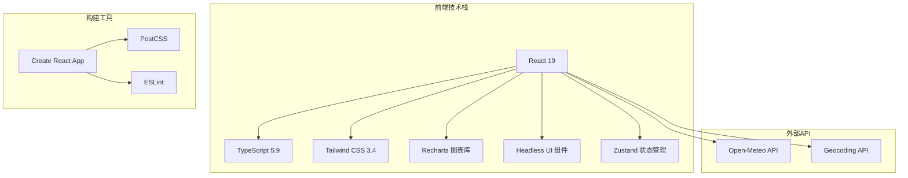

## 2. 整体架构

### 2.1 系统架构图

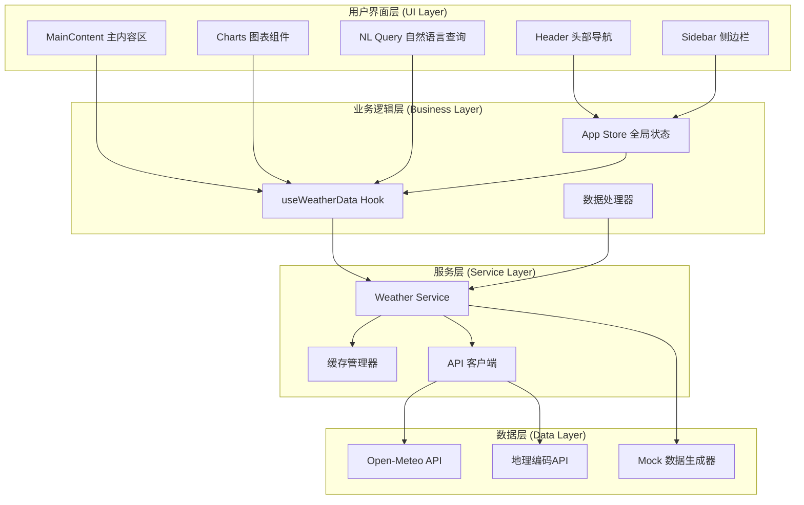

## 3. 核心子系统详解

### 3.1 用户界面层 (UI Layer)

#### 3.1.1 组件结构图

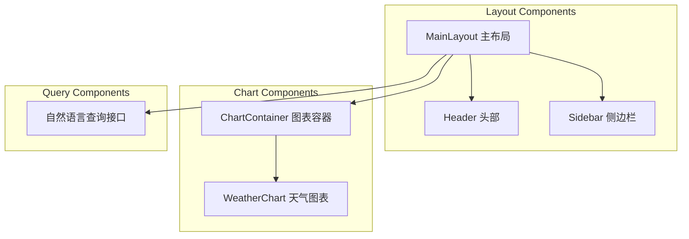

#### 3.1.2 响应式设计流程

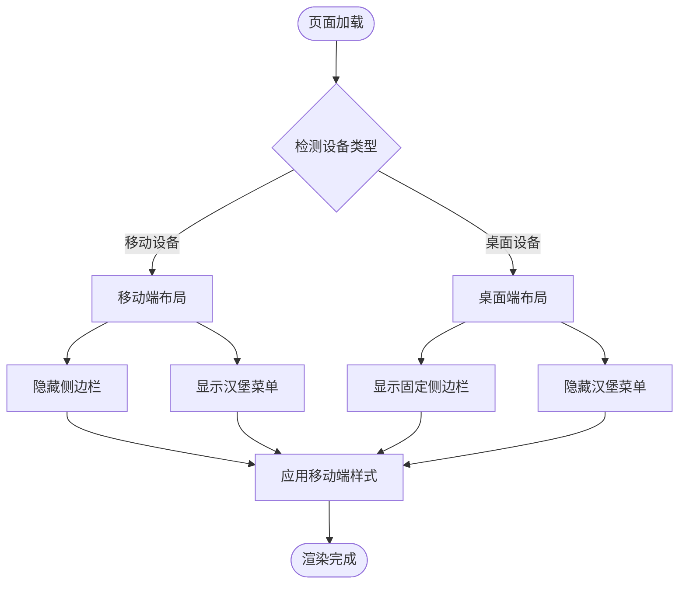

### 3.2 状态管理系统

#### 3.2.1 Zustand Store 架构

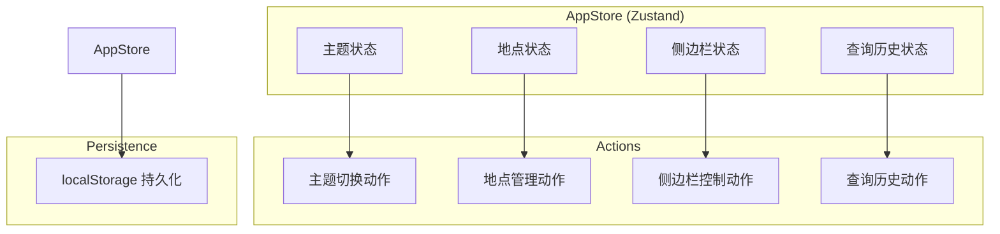

#### 3.2.2 状态流转图

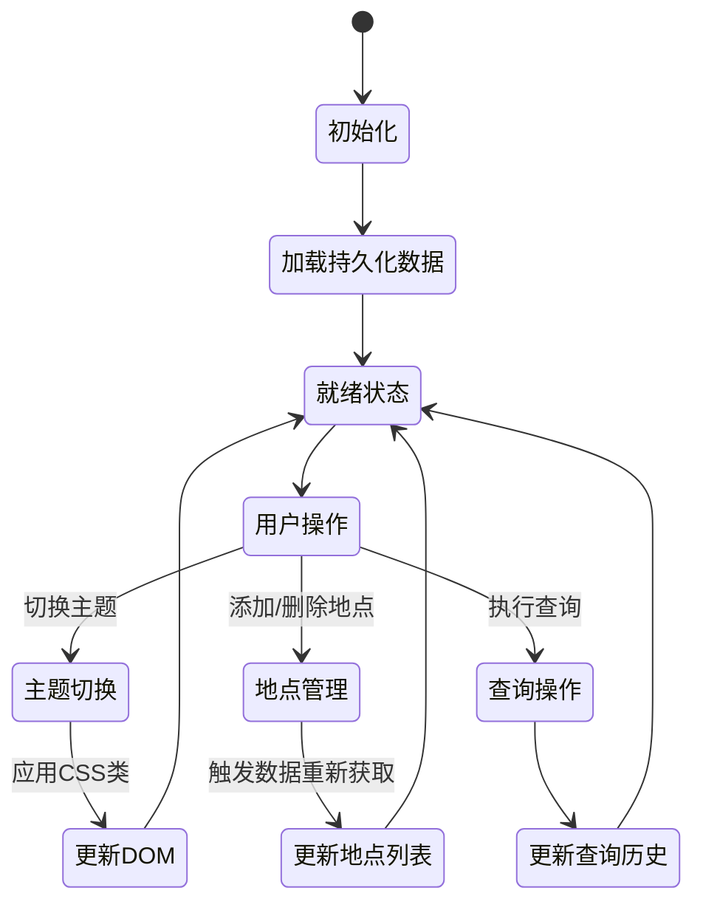

### 3.3 数据获取和处理系统

#### 3.3.1 数据流架构

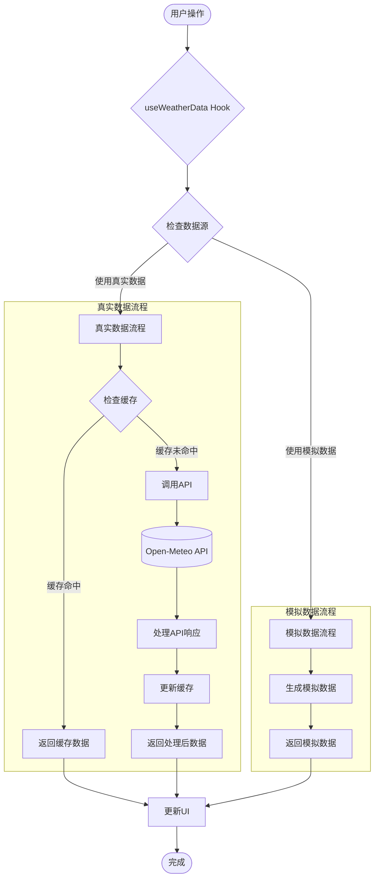

#### 3.3.2 API 集成架构

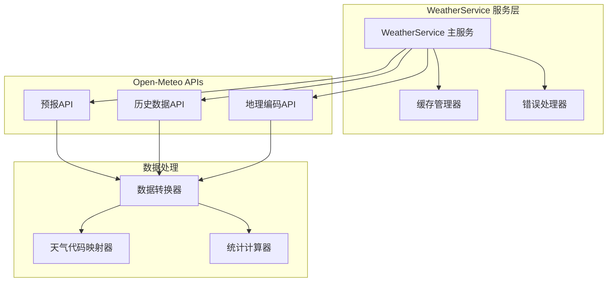

### 3.4 图表可视化系统

#### 3.4.1 图表组件层次结构

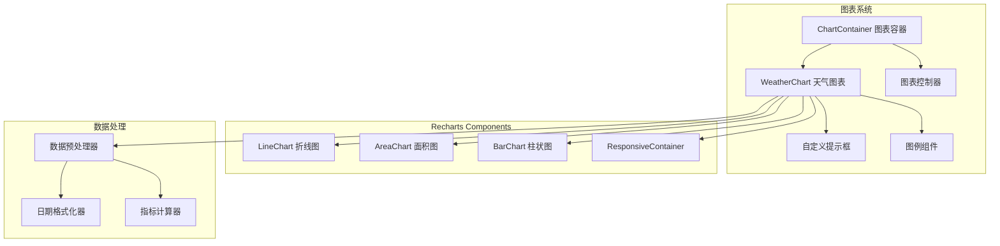

#### 3.4.2 图表数据流处理

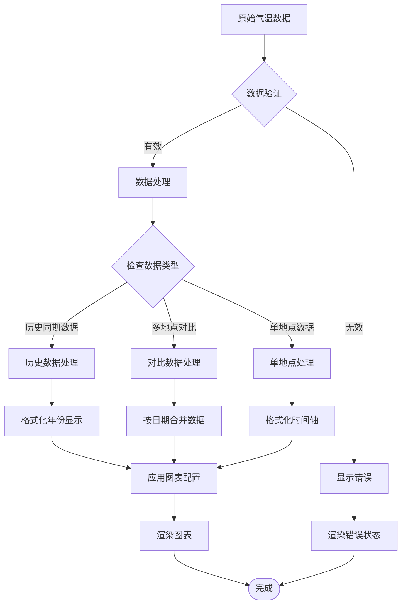

### 3.5 智能搜索系统

#### 3.5.1 地点搜索流程

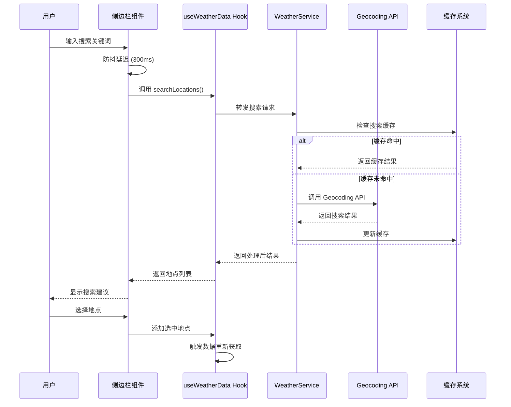

#### 3.5.2 自然语言查询架构 (未来扩展)

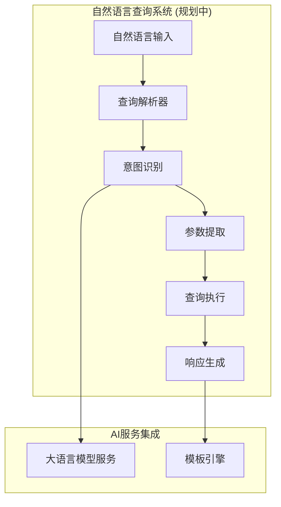

## 4. 数据模型

### 4.1 核心数据结构

```mermaid
classDiagram
    class WeatherDataPoint {
        +string timestamp
        +string date
        +number temperature
        +number temperatureMax
        +number temperatureMin
        +number humidity
        +number pressure
        +number windSpeed
        +number windDirection
        +number precipitation
        +string weatherCondition
        +string location
        +number latitude
        +number longitude
    }
    
    class Location {
        +string id
        +string name
        +number latitude
        +number longitude
        +string country
        +string timezone
        +string? admin1
        +string? admin2
    }
    
    class HistoricalStats {
        +number avgTemperature
        +number maxTemperature
        +number minTemperature
        +number temperatureRange
        +number avgHumidity
        +number totalPrecipitation
        +string? hottestYear
        +string? coldestYear
        +number temperatureTrend
        +number dataPoints
    }
    
    class QueryHistoryItem {
        +string id
        +string text
        +string timestamp
        +any? result
    }
    
    WeatherDataPoint ||--o{ Location : "belongs to"
    WeatherDataPoint ||--|| HistoricalStats : "generates"
```

### 4.2 API 响应模型

```mermaid
classDiagram
    class OpenMeteoCurrentResponse {
        +number latitude
        +number longitude
        +string timezone
        +CurrentWeather current
    }
    
    class OpenMeteoHistoricalResponse {
        +number latitude
        +number longitude
        +string timezone
        +DailyWeather daily
    }
    
    class CurrentWeather {
        +string time
        +number temperature_2m
        +number relative_humidity_2m
        +number surface_pressure
        +number wind_speed_10m
        +number wind_direction_10m
        +number weather_code
    }
    
    class DailyWeather {
        +string[] time
        +number[] temperature_2m_max
        +number[] temperature_2m_min
        +number[] temperature_2m_mean
        +number[] relative_humidity_2m
        +number[] surface_pressure
        +number[] wind_speed_10m_max
        +number[] wind_direction_10m_dominant
        +number[] precipitation_sum
        +number[] weather_code
    }
    
    OpenMeteoCurrentResponse ||--|| CurrentWeather : contains
    OpenMeteoHistoricalResponse ||--|| DailyWeather : contains
```

## 5. 性能优化策略

### 5.1 缓存策略

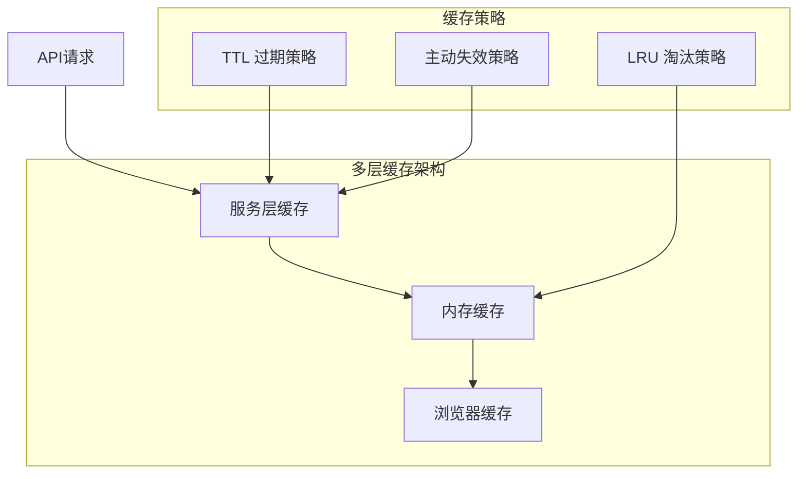

### 5.2 数据加载优化

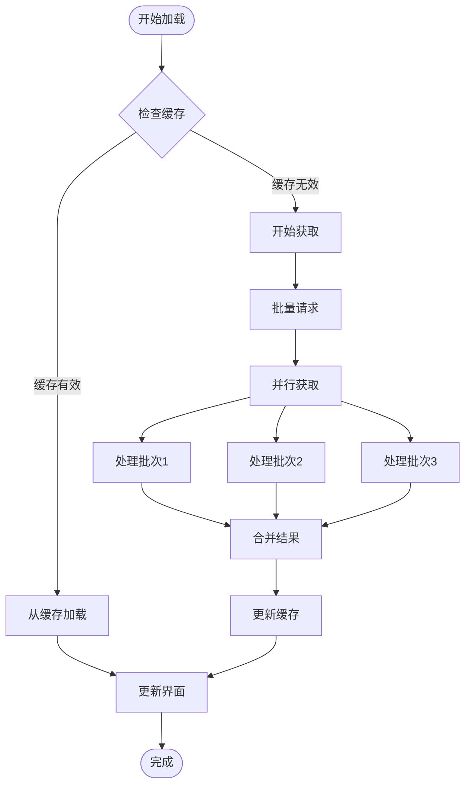

## 6. 错误处理和容错机制

### 6.1 错误处理流程

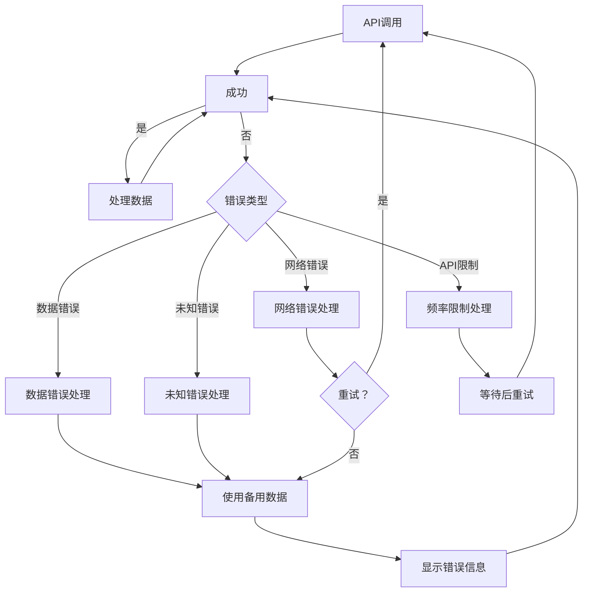

### 6.2 容错策略

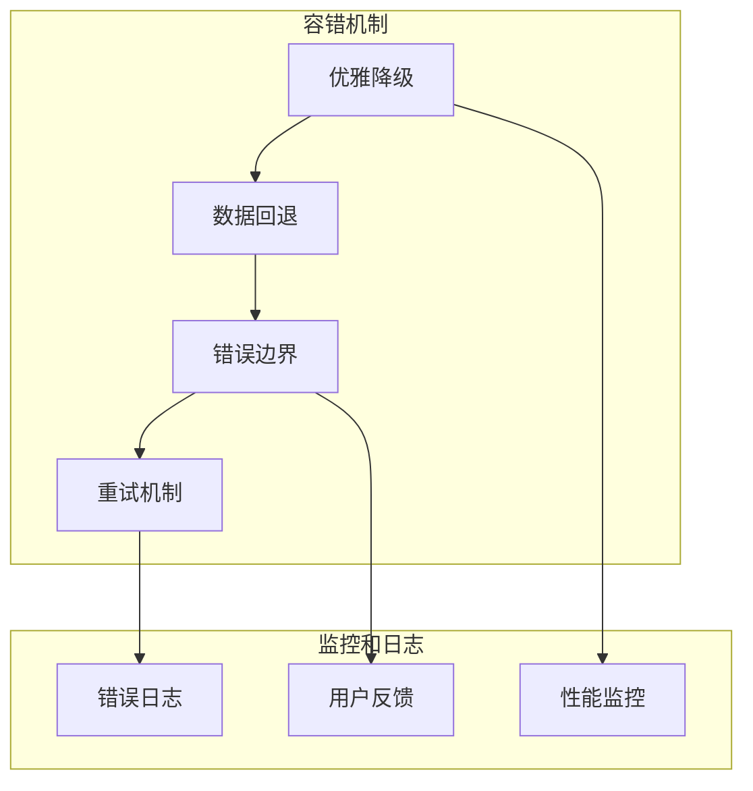

## 7. 部署和构建流程

### 7.1 构建流程

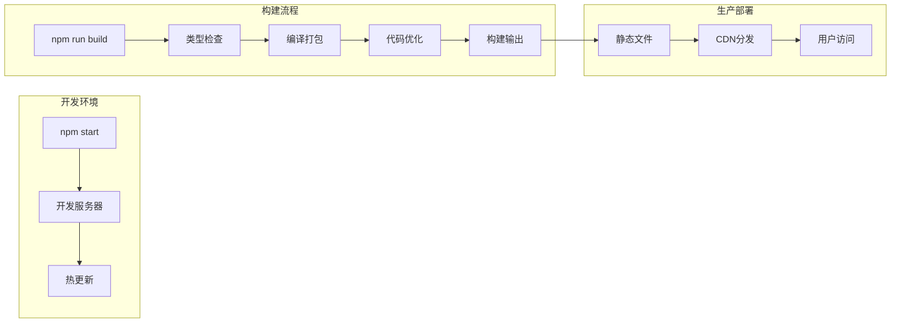

### 7.2 项目结构图

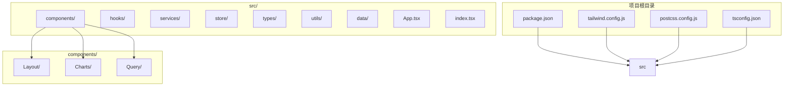

## 8. 未来扩展计划

### 8.1 功能扩展路线图

```mermaid
gantt
    title 功能开发路线图
    dateFormat  YYYY-MM-DD
    section 核心功能
    真实数据集成           :done,    core1, 2024-01-01, 2024-01-15
    基础可视化            :done,    core2, 2024-01-01, 2024-01-15
    响应式设计            :done,    core3, 2024-01-01, 2024-01-15
    
    section 智能功能
    自然语言查询           :active,  ai1, 2024-01-16, 2024-02-15
    智能分析报告           :         ai2, 2024-02-16, 2024-03-15
    预测分析功能           :         ai3, 2024-03-16, 2024-04-15
    
    section 数据扩展
    更多数据源集成          :         data1, 2024-02-01, 2024-03-01
    实时数据推送           :         data2, 2024-03-01, 2024-04-01
    数据导出功能           :         data3, 2024-04-01, 2024-04-15
    
    section 用户体验
    离线功能支持           :         ux1, 2024-04-16, 2024-05-15
    PWA 支持              :         ux2, 2024-05-16, 2024-06-15
    多语言支持            :         ux3, 2024-06-16, 2024-07-15
```

### 8.2 技术升级计划

```mermaid
graph TB
    subgraph "当前技术栈"
        CurrentReact[React 19]
        CurrentTS[TypeScript 5.9]
        CurrentTailwind[Tailwind CSS 3.4]
    end
    
    subgraph "计划升级"
        NextJS[迁移至 Next.js]
        ServerComponents[服务端组件]
        EdgeRuntime[边缘计算]
    end
    
    subgraph "新功能集成"
        WebAssembly[WebAssembly 数据处理]
        WebWorkers[Web Workers 并行计算]
        ServiceWorker[Service Worker 缓存]
    end
    
    CurrentReact --> NextJS
    CurrentTS --> ServerComponents
    CurrentTailwind --> EdgeRuntime
    
    NextJS --> WebAssembly
    ServerComponents --> WebWorkers
    EdgeRuntime --> ServiceWorker
```

## 9. 总结

本系统采用了现代化的前端架构设计，具备以下特点：

- 🏗️ **模块化架构**: 清晰的分层设计，便于维护和扩展
- 🚀 **性能优化**: 多层缓存、并行数据获取、智能错误处理
- 📱 **响应式设计**: 完美适配移动端和桌面端
- 🔌 **API集成**: 灵活的数据源切换，支持真实数据和模拟数据
- 🎨 **可视化**: 丰富的图表展示，支持多种数据分析视角
- 🛡️ **容错机制**: 完善的错误处理和优雅降级策略

系统设计充分考虑了可扩展性和可维护性，为未来的功能扩展奠定了坚实基础。