# 用户使用指南 - 历史天气数据分析平台

## 📖 目录

1. [平台简介](#1-平台简介)
2. [快速开始](#2-快速开始)
3. [功能详解](#3-功能详解)
4. [操作流程](#4-操作流程)
5. [数据分析](#5-数据分析)
6. [常见问题](#6-常见问题)
7. [技巧与建议](#7-技巧与建议)

## 1. 平台简介

历史天气数据分析平台是一个专业的天气数据可视化分析工具，帮助用户深入了解历史天气变化趋势，支持全球任意城市的天气数据查询与分析。

### 1.1 主要功能

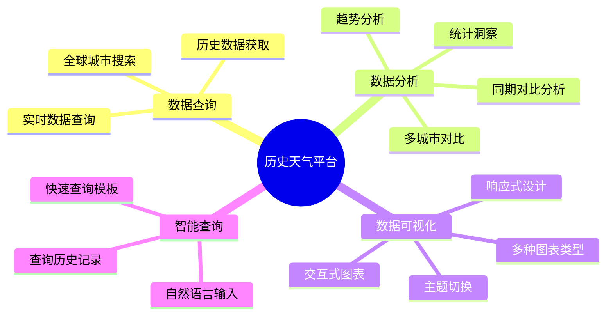

### 1.2 平台特色

- 🌍 **全球覆盖**: 支持全球任意城市天气数据查询
- 📊 **多维分析**: 提供温度、湿度、气压、风速等多维度分析
- 📈 **趋势洞察**: 20年历史数据对比，发现气候变化趋势
- 🎯 **精确定位**: 基于经纬度的精确地理定位
- 📱 **响应式设计**: 完美适配手机、平板、电脑等多种设备
- ⚡ **实时更新**: 基于真实API数据，确保数据准确性

## 2. 快速开始

### 2.1 界面概览

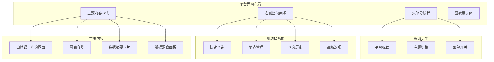

### 2.2 首次使用

1. **访问平台**: 在浏览器中打开 `http://localhost:3001`
2. **查看默认数据**: 平台默认显示上海过去20年同期天气数据
3. **熟悉界面**: 浏览各个功能模块，了解基本布局

### 2.3 基础操作

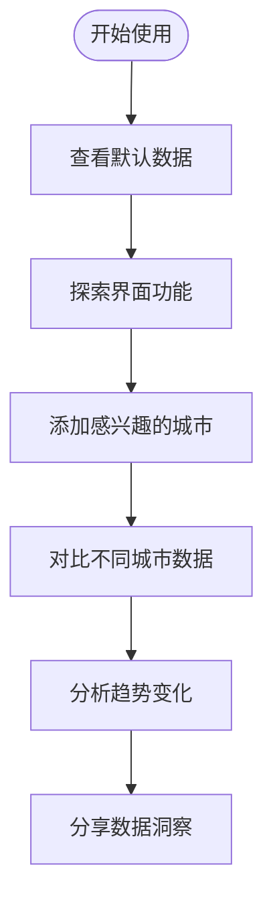

## 3. 功能详解

### 3.1 地点管理系统

#### 3.1.1 添加地点

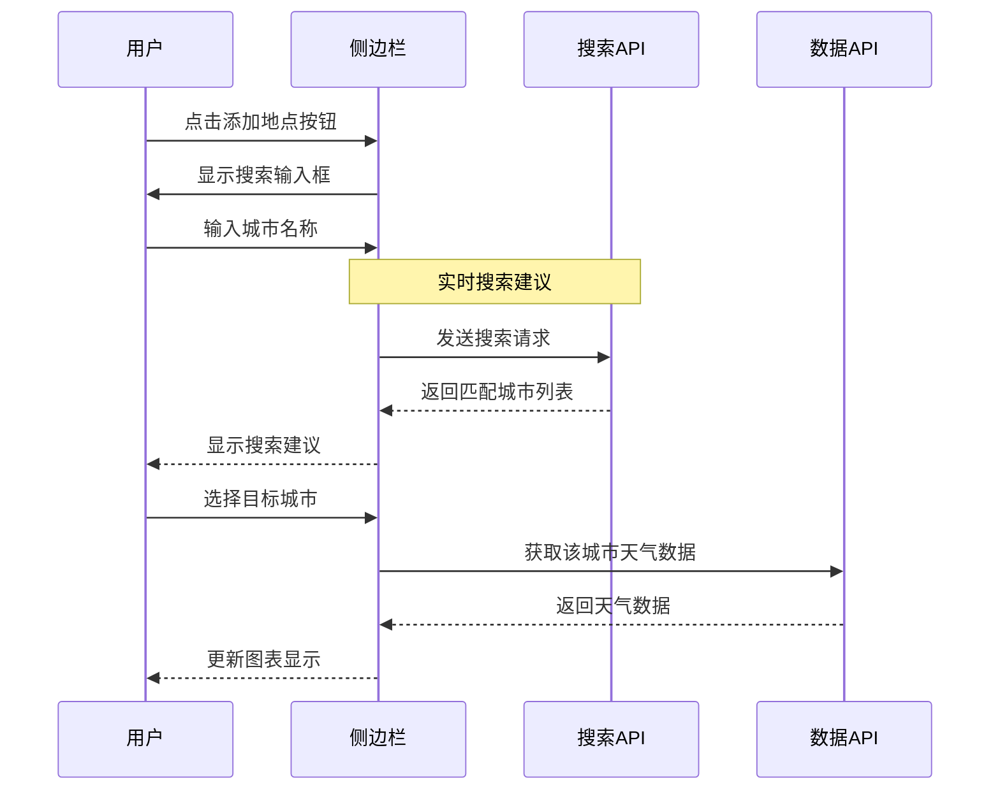

**操作步骤:**
1. 点击侧边栏中的 ➕ 按钮
2. 在搜索框中输入城市名称（支持中英文）
3. 从下拉建议中选择目标城市
4. 系统自动获取数据并更新图表

**搜索技巧:**
- 支持模糊搜索，输入城市部分名称即可
- 支持多语言搜索（中文、英文等）
- 显示城市的国家和行政区信息便于区分
- 搜索结果按相关性排序

#### 3.1.2 地点管理

- **查看已选地点**: 在地点管理区域查看当前选中的城市列表
- **删除地点**: 点击地点右侧的 ❌ 按钮移除不需要的城市
- **清空所有地点**: 使用垃圾桶图标快速清空所有选中地点
- **地点信息**: 鼠标悬停查看城市的详细地理信息

### 3.2 数据可视化系统

#### 3.2.1 图表类型切换

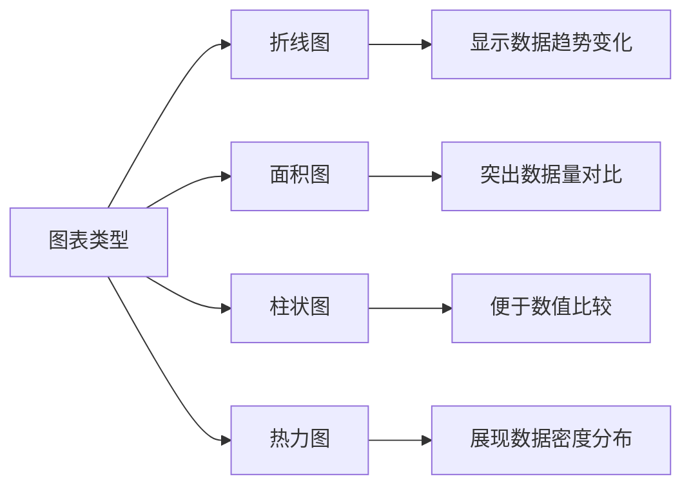

**各图表类型适用场景:**

| 图表类型 | 适用场景 | 特点 |
|---------|----------|------|
| 折线图 | 时间序列数据分析 | 清晰显示趋势变化 |
| 面积图 | 数据量对比分析 | 视觉冲击力强 |
| 柱状图 | 数值精确比较 | 便于读取具体数值 |
| 热力图 | 数据密度分析 | 适合大量数据展示 |

#### 3.2.2 交互功能

- **缩放**: 鼠标滚轮或手势缩放图表
- **平移**: 拖拽移动图表视窗
- **悬停提示**: 鼠标悬停显示详细数据
- **图例控制**: 点击图例隐藏/显示特定数据系列
- **全屏模式**: 点击全屏按钮获得更好的查看体验

### 3.3 自然语言查询

#### 3.3.1 查询语法

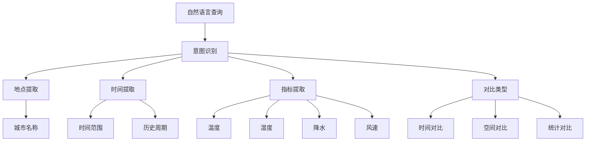

**支持的查询类型:**

1. **单城市历史查询**
   - "上海过去一年的温度变化"
   - "北京2023年的降水量情况"
   - "深圳今天和去年同期的温度对比"

2. **多城市对比查询**
   - "比较北京和上海的气温"
   - "上海、深圳、广州三城市湿度对比"
   - "中国主要城市降水量排行"

3. **趋势分析查询**
   - "全球气温变化趋势"
   - "上海过去20年同期温度趋势"
   - "夏季平均气温变化情况"

4. **统计分析查询**
   - "上海历史最高温度记录"
   - "北京年平均降水量"
   - "深圳湿度分布情况"

#### 3.3.2 查询历史管理

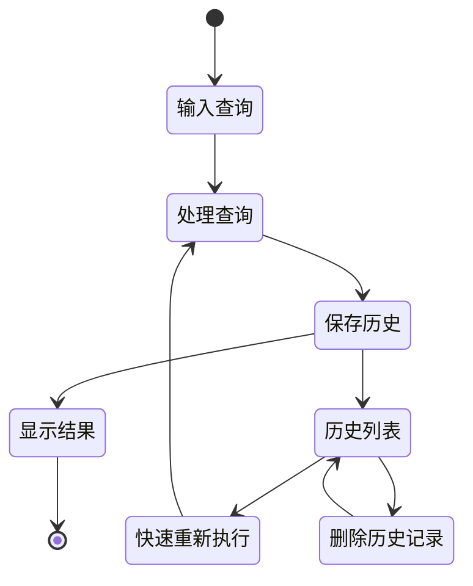

**历史记录功能:**
- **自动保存**: 每次查询自动保存到历史记录
- **快速重用**: 点击历史记录快速重新执行查询
- **时间排序**: 按查询时间倒序排列
- **记录清理**: 支持删除单条或清空所有历史记录

### 3.4 数据分析洞察

#### 3.4.1 统计指标

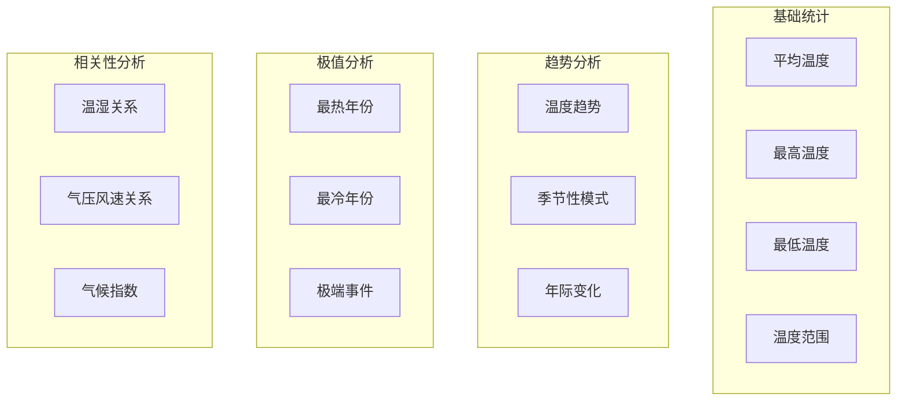

#### 3.4.2 洞察类型

1. **趋势洞察**
   - 📈 温度上升趋势："过去20年来，温度呈上升趋势，平均每年上升0.15°C"
   - 📉 下降趋势："湿度呈下降趋势，年平均下降0.5%"
   - 📊 稳定趋势："气压相对稳定，波动较小"

2. **极值洞察**
   - 🔥 历史极值："历史上最热的一天是2022年7月15日(42.3°C)"
   - 🥶 最冷记录："最冷记录出现在2018年1月24日(-8.1°C)"
   - 🌡️ 温差分析："历史温差达到15.4°C，气候变化较大"

3. **季节洞察**
   - 🌸 春季特征："春季平均温度18.5°C，降水较多"
   - ☀️ 夏季特征："夏季高温多湿，平均湿度85%"
   - 🍂 秋季特征："秋季温度适宜，天气晴朗较多"
   - ❄️ 冬季特征："冬季寒冷干燥，偶有雨雪天气"

## 4. 操作流程

### 4.1 单城市历史分析流程

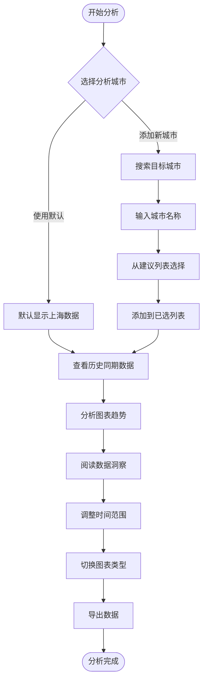

### 4.2 多城市对比流程

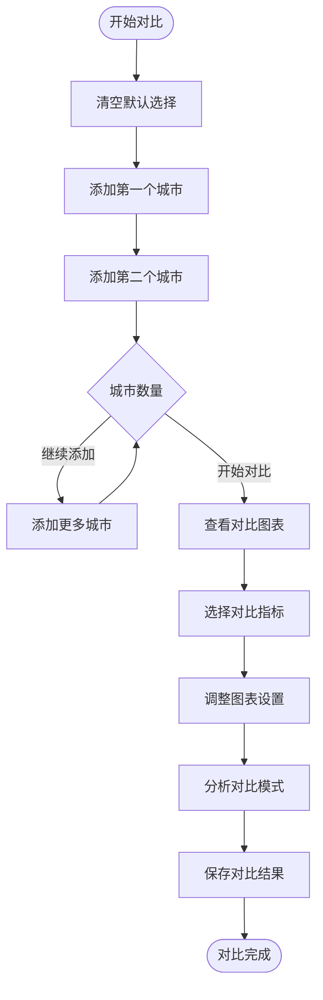

### 4.3 自然语言查询流程

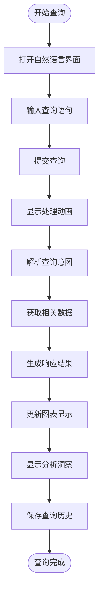

## 5. 数据分析

### 5.1 时间序列分析

#### 5.1.1 趋势识别

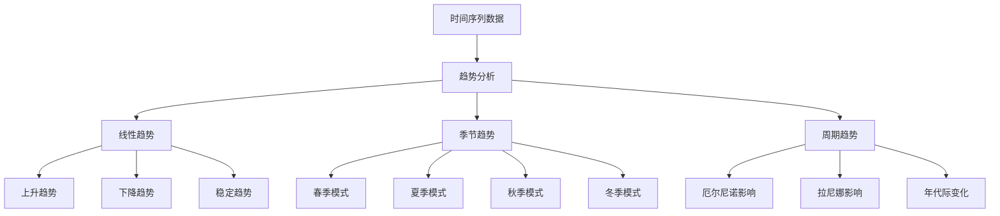

**趋势分析技巧:**
1. **观察总体走向**: 关注数据点的整体移动方向
2. **识别转折点**: 寻找趋势发生改变的关键时间点
3. **量化趋势强度**: 利用系统提供的趋势系数判断变化幅度
4. **对比不同时期**: 比较不同时间段的趋势特征

#### 5.1.2 异常值检测

**识别异常天气事件:**
- **极端高温**: 超过历史同期平均值2个标准差以上
- **极端低温**: 低于历史同期平均值2个标准差以下
- **异常降水**: 单日降水量超过月平均值的50%
- **持续异常**: 连续多天出现异常值的情况

### 5.2 空间对比分析

#### 5.2.1 地理因素影响

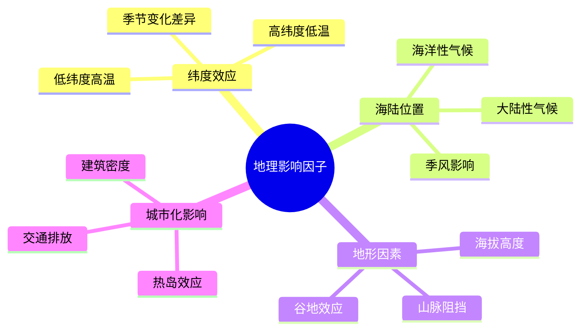

#### 5.2.2 对比分析方法

1. **同纬度城市对比**: 比较相似纬度城市的气候差异
2. **海陆对比**: 分析沿海与内陆城市的差异
3. **南北对比**: 研究不同纬度带的气候特征
4. **发展程度对比**: 比较不同发展水平城市的气候变化

### 5.3 统计分析方法

#### 5.3.1 描述性统计

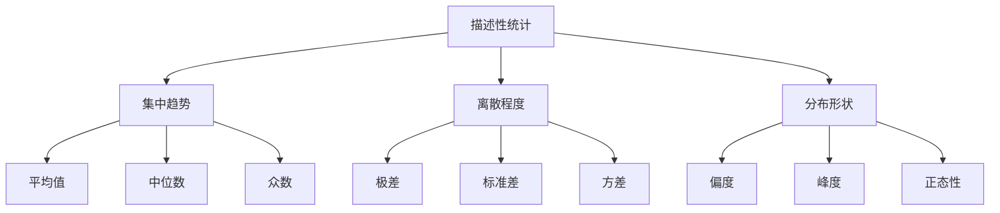

#### 5.3.2 相关性分析

**常见相关关系:**
- **温度与湿度**: 通常呈负相关，温度高时湿度相对较低
- **气压与天气**: 高气压通常对应晴朗天气
- **风速与温差**: 风速大时温差可能较小
- **降水与湿度**: 降水与湿度呈正相关关系

## 6. 常见问题

### 6.1 数据相关问题

#### Q1: 为什么有些城市搜索不到？
**A1**: 可能的原因：
- 城市名称拼写错误，请检查输入
- 该城市可能没有气象站数据覆盖
- 尝试使用英文名称搜索
- 使用更大的行政区名称（如省份、州名）

#### Q2: 历史数据的准确性如何？
**A2**: 数据来源说明：
- 数据来自Open-Meteo专业气象API
- 基于全球气象站实测数据
- 经过质量控制和数据插值处理
- 部分地区可能存在数据缺失情况

#### Q3: 为什么图表显示"正在加载"很久？
**A3**: 可能的解决方案：
- 检查网络连接是否正常
- 尝试刷新页面重新加载
- 减少查询的时间范围或城市数量
- 清除浏览器缓存后重试

### 6.2 功能使用问题

#### Q4: 如何切换主题？
**A4**: 主题切换方法：
- 点击右上角的主题切换按钮（🌙/☀️图标）
- 支持浅色主题和深色主题
- 主题设置会自动保存到本地

#### Q5: 手机上如何使用？
**A5**: 移动端使用指南：
- 点击左上角汉堡菜单打开侧边栏
- 使用手势缩放和平移图表
- 支持触摸操作和语音输入
- 响应式布局适配各种屏幕

#### Q6: 如何导出数据？
**A6**: 数据导出功能：
- 点击图表右上角的设置按钮
- 选择导出格式（CSV、JSON、PNG等）
- 支持导出原始数据和图表图片
- 数据包含完整的时间戳和地理信息

### 6.3 技术问题

#### Q7: 浏览器兼容性如何？
**A7**: 支持的浏览器：
- Chrome 88+ ✅
- Firefox 85+ ✅
- Safari 14+ ✅
- Edge 88+ ✅
- 移动端Safari/Chrome ✅

#### Q8: 数据更新频率？
**A8**: 更新机制：
- 历史数据：固定不变，无需更新
- 当前数据：每小时更新一次
- 预报数据：每6小时更新一次
- 缓存时间：10分钟本地缓存

## 7. 技巧与建议

### 7.1 数据分析技巧

#### 7.1.1 选择合适的时间范围

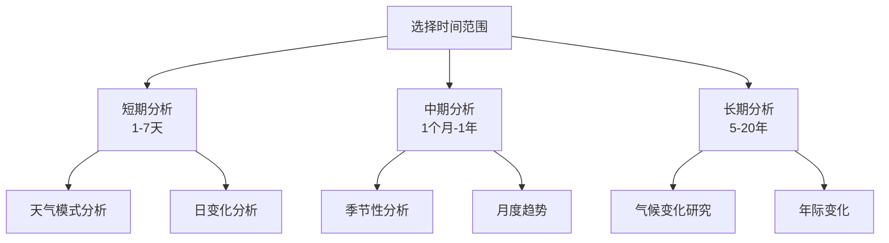

#### 7.1.2 图表类型选择建议

| 分析目的 | 推荐图表 | 原因 |
|---------|----------|------|
| 趋势分析 | 折线图 | 清楚显示变化趋势 |
| 数值比较 | 柱状图 | 便于比较具体数值 |
| 数据量对比 | 面积图 | 视觉效果突出 |
| 分布分析 | 热力图 | 显示数据密度分布 |

### 7.2 高效使用建议

#### 7.2.1 查询优化策略

1. **合理使用缓存**
   - 频繁查询的数据会被缓存
   - 10分钟内重复查询直接使用缓存
   - 清除缓存：刷新页面或清除浏览器数据

2. **批量操作技巧**
   - 一次性添加多个城市进行对比
   - 使用历史查询记录快速重复分析
   - 保存常用的查询配置

3. **性能优化**
   - 避免同时查询过多城市（建议不超过5个）
   - 合理选择时间范围，过长的时间范围会增加加载时间
   - 在网络较慢时优先查询重要数据

#### 7.2.2 分析工作流建议

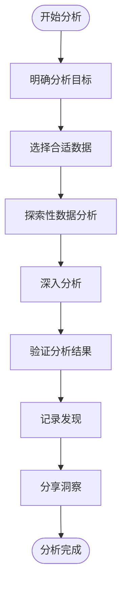

**分析工作流详解:**

1. **明确目标**: 在开始分析前明确要解决的问题
2. **选择数据**: 根据分析目标选择合适的城市、时间范围和指标
3. **探索数据**: 使用不同图表类型观察数据特征
4. **深入分析**: 关注异常值、趋势变化和相关性
5. **验证结果**: 通过对比分析验证发现的模式
6. **记录发现**: 使用查询历史记录重要的分析结果
7. **分享洞察**: 导出数据和图表与他人分享

### 7.3 专业分析建议

#### 7.3.1 气候研究应用

- **长期趋势分析**: 使用20年数据识别气候变化信号
- **极端事件研究**: 关注异常值和极端天气事件
- **区域气候对比**: 比较不同地区的气候特征差异
- **季节性变化**: 分析不同季节的气候变化模式

#### 7.3.2 实际应用场景

1. **农业规划**: 分析降水和温度模式指导作物种植
2. **旅游决策**: 了解目的地历史天气制定旅行计划
3. **能源管理**: 基于温度数据优化供暖制冷计划
4. **健康管理**: 关注气象条件对健康的影响
5. **城市规划**: 了解城市气候特征指导建设规划

---

💡 **提示**: 如遇到问题或需要更多帮助，请查看平台内的帮助文档或联系技术支持。

🎯 **目标**: 通过数据驱动的方式深入理解气候变化，为决策提供科学依据。

📈 **持续改进**: 我们会根据用户反馈持续优化平台功能，提供更好的分析体验。