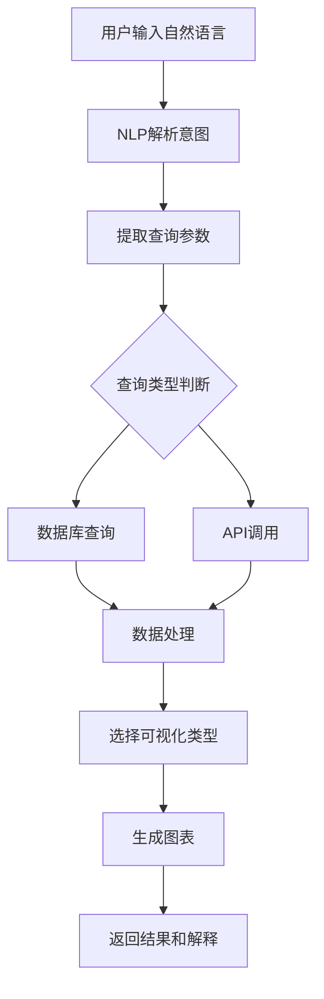

# 历史气温数据分析平台 - 产品需求文档 (PRD)

## 📋 产品概览

### 产品名称
Historical Temperature Analytics Platform (历史温度数据分析平台)

### 产品愿景
为用户提供直观、智能的历史气温数据分析工具，通过自然语言交互和丰富的图表可视化，让复杂的气象数据变得易于理解和分析。

### 目标用户
- **研究人员**: 气候变化研究、环境科学分析
- **数据分析师**: 商业决策、趋势分析
- **教育工作者**: 教学演示、学术研究
- **普通用户**: 个人兴趣、历史气温查询

## 🎯 核心功能需求

### 功能1: 历史气温数据比较

#### 1.1 多地点气温对比
**用户故事**: 作为研究人员，我希望能够比较不同城市过去20年的气温变化趋势，以便分析区域气候差异。

**功能描述**:

- 支持同时选择最多5个地点进行对比
- 时间范围: 过去20年 (2005-2025)
- 数据粒度: 年度/季度/月度平均值
- 可视化: 多线条折线图，不同颜色区分地点

**技术要求**:

```typescript
interface LocationComparison {
  locations: Array<{
    name: string;
    latitude: number;
    longitude: number;
    color: string;
  }>;
  timeRange: {
    startYear: number;
    endYear: number;
  };
  dataType: 'yearly' | 'seasonal' | 'monthly';
  metrics: Array<'temperature' | 'precipitation' | 'humidity'>;
}
```

#### 1.2 时间序列趋势分析
**用户故事**: 作为数据分析师，我希望看到某个地点气温的长期趋势线和异常值标注。

**功能描述**:

- 趋势线拟合 (线性回归)
- 异常值检测和高亮显示
- 统计信息显示 (平均值、最高/最低、标准差)
- 气候变化指标 (升温速率 °C/年)

### 功能2: 自然语言查询系统

#### 2.1 智能查询解析
**用户故事**: 作为普通用户，我希望能够用自然语言提问，如"北京2020年夏天比2010年夏天热了多少度？"

**支持的查询类型**:

1. **比较查询**
   - "上海和广州哪个城市夏天更热？"
   - "今年的冬天比去年冷多少？"

2. **趋势查询**  
   - "北京过去10年气温变化趋势如何？"
   - "全球变暖在中国有什么表现？"

3. **极值查询**
   - "北京历史上最热的一年是哪年？"
   - "2023年全国哪个城市最冷？"

4. **统计查询**
   - "深圳每年平均降雨量是多少？"
   - "成都一年中哪个月最潮湿？"

#### 2.2 查询处理流程


### 功能3: 智能图表可视化

#### 3.1 自适应图表选择
**逻辑规则**:

- **趋势数据** → 折线图
- **对比数据** → 柱状图/雷达图  
- **分布数据** → 直方图/箱线图
- **地理数据** → 热力图/地图可视化
- **相关性** → 散点图

#### 3.2 交互式图表功能

- **缩放和平移**: 支持图表区域放大查看
- **数据点悬停**: 显示具体数值和时间
- **图例切换**: 显示/隐藏特定数据系列
- **数据导出**: 支持PNG、SVG、CSV格式导出

## 🔧 技术架构需求

### 前端技术栈
- **框架**: React 19 + TypeScript
- **图表库**: Recharts / Chart.js / D3.js
- **地图**: Leaflet / MapBox
- **UI组件**: Ant Design / Material-UI
- **状态管理**: Zustand / Redux Toolkit

### 后端技术栈
- **API服务**: Node.js + Express / Python + FastAPI
- **数据库**: SQLite (开发) → PostgreSQL (生产)
- **缓存**: Redis (可选)
- **NLP服务**: OpenAI API / 本地模型

### 数据层设计
```sql
-- 历史气温数据表
CREATE TABLE weather_history (
    id INTEGER PRIMARY KEY,
    location_name VARCHAR(100),
    latitude DECIMAL(10, 8),
    longitude DECIMAL(11, 8),
    date DATE,
    temperature_avg DECIMAL(5, 2),
    temperature_max DECIMAL(5, 2),
    temperature_min DECIMAL(5, 2),
    humidity DECIMAL(5, 2),
    precipitation DECIMAL(7, 2),
    wind_speed DECIMAL(5, 2),
    pressure DECIMAL(7, 2),
    created_at TIMESTAMP DEFAULT CURRENT_TIMESTAMP
);

-- 查询缓存表
CREATE TABLE query_cache (
    id INTEGER PRIMARY KEY,
    query_hash VARCHAR(64),
    query_text TEXT,
    result_data TEXT,
    chart_config TEXT,
    expires_at TIMESTAMP,
    created_at TIMESTAMP DEFAULT CURRENT_TIMESTAMP
);
```

## 📊 用户界面设计

### 主界面布局
```
┌─────────────────────────────────────────────────────┐
│                    导航栏                              │
├─────────────────┬───────────────────────────────────┤
│                 │                                    │
│   侧边栏         │            主内容区                │
│                 │                                    │
│ • 快速查询       │  ┌─────────────────────────────┐    │
│ • 地点管理       │  │        图表显示区域          │    │
│ • 历史记录       │  │                             │    │
│ • 设置选项       │  └─────────────────────────────┘    │
│                 │                                    │
│                 │  ┌─────────────────────────────┐    │
│                 │  │      自然语言查询输入框      │    │
│                 │  └─────────────────────────────┘    │
│                 │                                    │
└─────────────────┴───────────────────────────────────┘
```

### 关键页面

#### 1. 首页 - 智能查询
- 大型搜索输入框
- 示例查询提示
- 最近查询历史
- 热门查询推荐

#### 2. 数据比较页面  
- 地点选择器 (搜索 + 地图点击)
- 时间范围滑块
- 指标选择器 (多选)
- 实时图表更新

#### 3. 结果展示页面
- 主图表区域
- 数据摘要卡片
- 洞察和解释文本
- 分享和导出按钮

## 🚀 MVP功能范围

### Phase 1 (4周) - 基础功能
- [ ] 历史气温数据导入和存储
- [ ] 基础折线图可视化
- [ ] 单地点数据查询
- [ ] 简单的时间范围选择

### Phase 2 (3周) - 对比功能  
- [ ] 多地点数据对比
- [ ] 多种图表类型支持
- [ ] 数据导出功能
- [ ] 响应式界面设计

### Phase 3 (4周) - 智能查询
- [ ] 自然语言查询解析
- [ ] 查询意图识别
- [ ] 自动图表生成
- [ ] 查询结果缓存

### Phase 4 (2周) - 优化增强
- [ ] 性能优化
- [ ] 用户体验改进
- [ ] 错误处理完善
- [ ] 部署和监控

## 📈 成功指标

### 用户体验指标
- **查询响应时间**: < 2秒
- **图表加载时间**: < 1秒  
- **自然语言查询准确率**: > 85%
- **用户会话时长**: > 5分钟

### 技术性能指标
- **数据库查询性能**: < 500ms
- **API响应时间**: < 1秒
- **系统可用性**: > 99%
- **并发用户支持**: > 100

## 🔒 非功能性需求

### 数据质量
- **准确性**: 使用权威数据源 (NOAA, Meteostat)
- **完整性**: 覆盖全球主要城市，时间跨度20年+
- **实时性**: 历史数据每日更新

### 安全性  
- **数据传输**: HTTPS加密
- **API限流**: 防止滥用
- **隐私保护**: 不收集用户个人信息

### 可扩展性
- **数据库**: 支持SQLite到PostgreSQL迁移
- **微服务**: 模块化架构设计
- **云部署**: 支持容器化部署

## 📋 验收标准

### 核心功能验收
1. **历史数据对比**
   - ✅ 能够选择5个不同城市
   - ✅ 显示20年气温趋势折线图
   - ✅ 支持年/季/月粒度切换

2. **自然语言查询**  
   - ✅ 准确理解比较类查询
   - ✅ 自动生成合适的图表类型
   - ✅ 提供数据解释和洞察

3. **用户体验**
   - ✅ 响应式设计适配移动端
   - ✅ 直观的交互操作
   - ✅ 清晰的错误提示

这个PRD文档为历史气温数据分析平台提供了完整的产品规划，既满足了核心的数据比较和自然语言查询需求，又考虑了技术实现的可行性和未来的扩展性。